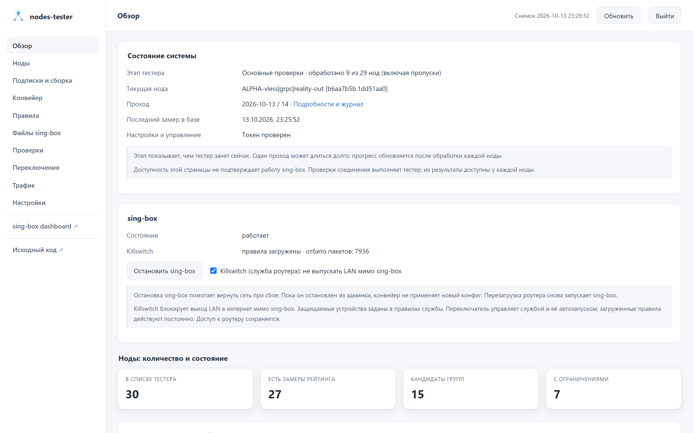

**English** | [Русский](README.ru.md)

# nodes-tester

Management of sing-box proxy nodes on OpenWrt: fetching subscriptions, building nodes and groups, quality checks, automatic switching and a web admin panel.

The project works with an already installed sing-box. It does not install the proxy core and does not configure router routing for the user. The first run needs SSH access and a basic knowledge of sing-box configuration.

<picture>
  <source media="(prefers-color-scheme: dark)" srcset="docs/screenshots/overview.png">
  <source media="(prefers-color-scheme: light)" srcset="docs/screenshots/overview-light.png">
  
</picture>

<p align="center">
  System overview, nodes, check results and control in one interface.
  <a href="docs/screenshots/README.md">All screens</a>
</p>

## Getting started

Quick install on a clean OpenWrt 25.x: sing-box-lx and nodes-tester with a minimal config
(TUN, sniffing and DNS hijacking without subscriptions, all traffic goes directly for now); details are in the [guide](openwrt/README.md#quick-install):

```sh
wget -qO- https://raw.githubusercontent.com/ancored/nodes-tester/master/openwrt/install.sh | sh -s -- 'https://provider.example/sub/YOUR-TOKEN'
```

Manual install:

1. Download the package from the [releases](https://github.com/ancored/nodes-tester/releases).
2. Follow [installation and first run on OpenWrt](openwrt/README.md).
3. Open the [guide to the admin panel and everyday work](docs/USAGE.md). Every page and block of the admin panel
   is explained in detail in the [help](docs/help/README.md), with flowcharts of the algorithms; the admin panel shows it
   by the **?** icons.

Current release: [`v0.8.0-r2`](https://github.com/ancored/nodes-tester/releases/tag/v0.8.0-r2). It needs sing-box 1.14 or newer with the API service (`services[type=api]`). The release has an `.apk` for OpenWrt 25.x. OpenWrt 24.10 needs a separately built `.ipk`. The package is signed with the project key and is available from the `apk` repository on GitHub Pages; how to add it is described in the [guide](openwrt/README.md).

## How updates work

```text
Router subscriptions → fetch → raw/router.json → build → nodes.json
                                              + sing-box base and rules
                                              → check → apply → connectivity check

Client subscriptions → fetch → whnodes.json + client bases
                                  → /etc/sing-box-clients/ → web server → client links
```

The pipeline keeps the previous data when a fetch fails, checks the resulting config before replacing it and brings back the working version if connectivity is lost after a restart. The client branch builds separate files and does not switch the router sing-box. Details and the manual run order are in the [guide](docs/USAGE.md#how-subscriptions-and-configs-are-updated).

The admin panel shows the tester state, measurement history, traffic and switches. In it you can configure subscriptions and groups, run the pipeline, set the schedule, read the logs, edit the sing-box source files and manage nodes. The “Rules” page checks and applies the base with presets without fetching subscriptions again. Changes need the administrator token. The interface is in English and Russian: the browser language by default, the choice is remembered.

## Good to know

- The parsers understand XHTTP and AmneziaWG, but the regular sing-box does not accept them. These nodes
  need `sing-box-lx`; with the regular core exclude them at the `nodes_config` stage.
  See [compatibility with sing-box cores](docs/SING_BOX_COMPATIBILITY.md).
- Saving subscriptions, applying new nodes and checking the current nodes are started separately. Saving in the admin panel does not update sing-box.
- Checks create network traffic and download test files. The tester itself picks the active node in each sing-box group by the group checks (exit country, IP type, access to AI services); the country is measured, not taken from the provider's node name. Scheduled rotation can be turned off.
- The admin panel is built into the tester. After installation the service and the web interface are off until you configure and enable them.
- Working configs contain secrets. Do not publish subscription URLs, tokens, the statistics database or full diagnostic output. Do not expose the admin panel directly to the internet.

## Module documentation

The main README covers only the first-run path. Each component is described
next to its code:

| Component | Description |
|---|---|
| [`nodes_fetch`](nodes_fetch/README.md) | sources, parsers, last-good and the `raw_nodes.json` format |
| [`nodes_config`](nodes_config/README.md) | filters, names, node keys, groups and `nodes.json` |
| [`nodes_tester`](nodes_tester/README.md) | checks, rating, switching, monitor and SQLite |
| [`nodes_admin`](nodes_admin/README.md) | pipeline, schedule and rule updates |
| [`dashboard`](dashboard/README.md) | HTTP server modes, API, access and file handling |
| [`web`](web/README.md) | Vue sources, build and interface rules |
| [`nodes_common`](nodes_common/README.md) | the raw contract, atomic writes and locks |
| [`naming`](naming/README.md) | node key and protocols |
| [`scripts/router`](scripts/router/README.md) | apply, check, rollback and the client pipeline |

Also: [help](docs/help/README.md), [config.json](docs/CONFIG.md), [how the sing-box config is assembled](docs/CONFIG_ASSEMBLY.md), [sing-box compatibility](docs/SING_BOX_COMPATIBILITY.md),
[everyday work](docs/USAGE.md), [router security model](docs/SECURITY_MODEL.md)
and [the OpenWrt package](openwrt/README.md).

## Installing from source

Python 3.8 or newer is required. From the repository root run `python3 -m pip install -r requirements.txt`, create `config/config.json` from the [template](config/config.example.json), connect sing-box the same way as in the OpenWrt guide and run `python3 -m nodes_tester -c config/config.json`. Instead of the package command `nodes-tester fetch/config` use `python3 -m nodes_fetch` and `python3 -m nodes_config`.

The built web assets are included in the repository; Node.js is not needed to run it. The OpenWrt package is built by the [SDK script](openwrt/build.sh). `--help` shows the command options, all settings are described in [CONFIG.md](docs/CONFIG.md).

## License

Copyright © 2026 Andrey Dyadyk

nodes-tester is free software: you can redistribute it and/or modify it under the terms of the
[GNU Affero General Public License](LICENSE) version 3 or (at your option) any later
version (`AGPL-3.0-or-later`). The program is distributed without any warranty.
If you give network access to a modified version, for example to the admin panel, its users must
be able to get its source code; the “Source code” link in the admin panel points to the code of the
running version.

Third-party components in the admin panel and the OpenWrt package are Vue and Vue Router (MIT),
[country-flag-emoji-polyfill](https://github.com/talkjs/country-flag-emoji-polyfill) (MIT;
flag images are [Twemoji](https://github.com/twitter/twemoji), CC-BY 4.0) and
[PySocks](https://github.com/Anorov/PySocks) (BSD-3-Clause); their licenses are in
[THIRD_PARTY_LICENSES](THIRD_PARTY_LICENSES).

The keys for decrypting Happ links are not part of the project: if such subscriptions are used, they
are downloaded from a source set by the user (by default
[Omegaplexx/hpwnr](https://github.com/Omegaplexx/hpwnr)).

sing-box and sing-box-lx (GPL-3.0) are not part of the project: the tester runs the installed sing-box as
a separate program and talks to its API.
