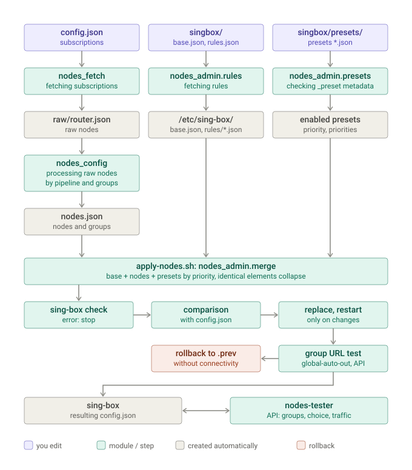

**English** | [Русский](CONFIG_ASSEMBLY.ru.md)

# How the sing-box config is assembled

[About the project](../README.md) · [Guide](USAGE.md) · [Router scripts](../scripts/router/README.md)

The resulting `/etc/sing-box/config.json` on the router is assembled from three chains: nodes from
subscriptions, the base with rule sets, and rule presets. All three meet in `apply-nodes.sh`.

<p align="center"></p>

## Inputs

| What | Where | Processed by | Result |
|---|---|---|---|
| Subscriptions | `config.json`, the `subscriptions` section | `nodes_fetch`: fetching subscriptions | `raw/router.json`: raw nodes |
| Node build | `config.json`, the `pipeline.router` and `groups` sections | `nodes_config`: filters, names, groups | `/opt/nodes-tester/nodes.json`: nodes and the groups `{group}-auto-out`, `failsafe-out`, `global-auto-out`, `nodes-tester` |
| Base | `singbox/base.json` | `nodes_admin.rules`: copies it | `/etc/sing-box/base.json` |
| Rule set sources | `singbox/rules.json` | `nodes_admin.rules`: fetching the rules | `/etc/sing-box/rules/*` |
| Rule presets | `singbox/presets/*.json` | `nodes_admin.presets`: checks `_preset`, selects the enabled ones | enabled presets with priorities |

`singbox/` is the `/etc/nodes-tester/singbox/` directory of the package installation; these files are edited in the
admin panel (“sing-box files”, “Rules”). `config.json` is edited in “Subscriptions and build” and “Settings”; the field reference is
[CONFIG.md](CONFIG.md).

The base holds what is always needed: inbounds, shared DNS servers, `final`, the API service.
Routing and DNS rules, as well as the DNS servers and rule sets needed only by them, live
in presets. A preset is a fragment of a sing-box config (any sections) with `_preset` metadata:
title, whether it is enabled, priority, priority overrides, required groups.

## Merging

`apply-nodes.sh` merges the inputs with its own merger (`nodes_admin.merge`, called as
`python3 -m nodes_admin.presets assemble`). `sing-box merge` is not used: it merges
inputs by file name, does not collapse identical elements and rewrites the config into the canonical
form of its version. The order of sources:

```text
base.json          ← above all
nodes.json         ← nodes and groups
presets/*.json     ← enabled presets by priority (lower goes first), by name on a tie
```

```json
"_preset": { "priority": 300, "priorities": { "dns.rules": 150 } }
```

`priorities` overrides the preset priority for a single path: here the DNS rules of the preset
come before its route rules. Inside a preset the order of elements does not change.

| What | How it is merged |
|---|---|
| Objects | recursively |
| Arrays | elements in the priority order of the sources for this path |
| Element with `tag` | an identical object collapses to the first one; the same `tag` with different content is an error naming both sources |
| Element without `tag` | an identical one collapses to the first, the repeat is logged |
| Scalars | `base.json` always wins; between presets the lower priority wins; a losing different value is logged; different values with equal priority are an error |

That is why a preset declares the DNS servers and `rule_set` it needs itself, even if the same objects
are in another preset: matching objects collapse. The `_preset` key does not get into the resulting
config. The content of the inputs passes unchanged: for example, `certificate_path` stays a
path, and sing-box rereads the updated certificate itself.

## Preset library

[`config/singbox/presets/`](../config/singbox/presets) is a set of ready presets, a starting point
for your own rules; in the package they are in `/usr/share/nodes-tester/examples/singbox/presets/`. All of them
are off: copy the ones you need to `singbox/presets/`, put in your own values and enable them in
“Rules”. The rule sets they refer to are listed in
[`rules.example.json`](../config/singbox/rules.example.json); on the first installation it becomes
`singbox/rules.json`, and the examples of local lists `us-domains.json` and `ru-also-domains.json`
are copied to `singbox/rules/`.

### Outbounds and DNS servers

Presets refer not to node groups but to zone outbounds. Each outbound is declared by a separate router preset
or by the client base, so the same logic fits both the router and a client:

| Outbound | Purpose | On the router | On a client |
|---|---|---|---|
| `ai-out` | Claude, OpenAI, Grok, Perplexity, the `ai` user | `out-ai` → `ai-auto-out` | router, the `ai` user |
| `google-out` | Gemini and Google addresses | `out-ai` → `ai-auto-out` | router, the `global` user |
| `us-out` | the `us` user, `us-domains` | `out-us` → `us-auto-out` | router, the `us` user |
| `global-out` | browser STUN | — | router, the `global` user |
| `home-out` | home network and home IP | — | router, the `ru-strict` user |
| `direct-out`, `direct-lan`, `global-auto-out`, `nodes-tester` | direct outbound, LAN, all nodes, tester | base and `nodes.json` | `global-auto-out`: the client groups (`whnodes.json`) |

A zone outbound is a selector with one element. To send AI through your own proxy it is enough
to change the `ai-out` element in `out-ai`. Presets declare DNS servers themselves, on public addresses:
`dns-direct` is Yandex DoT `77.88.8.8` (Russian answers for direct traffic), `dns-ai`,
`dns-google`, `dns-us`, `dns-global` are DoH through their own outbound, `dns-home` goes through home, `dns-wh`
through the client group nodes. Replace them with your own (for example, NextDNS profiles) in the preset copies.

### Order

| Priority | Layer |
|---|---|
| 50 | router zone outbounds |
| 90–130 | core, blocking, local network, untrusted LAN, IP check |
| 150 | a client mode that decides everything itself (“Whitelists”) |
| 200–225 | AI and Google, AI apps, STUN |
| 280–310 | US, the “Abroad” mode, RU directly, the `ru-strict` user |
| 400 | the `global` user |
| 900–999 | RU and BY `geoip`, `route.final` |

AI stands above the `auth_user` rules: AI and Google services go to their outbounds for any
user. The “Abroad” mode comes after AI and US but before the RU rules: Russian services
go through home, the rest directly.

### Catalogue

| Preset | Where | What it does |
|---|---|---|
| `out-ai`, `out-us` | router | declare `ai-out`, `google-out`, `us-out` from the `ai` and `us` groups |
| `core` | router | `sniff`, DNS hijacking, the domain of an IP from DNS answers (`dns.reverse_mapping`), local addresses → `direct-lan`, the tester; the URL test domain goes through `bootstrap` |
| `untrusted-lan` | router | LAN outside the trusted segment → `direct-out`; see the [security model](SECURITY_MODEL.md#trust-model) |
| `block-ads`, `block-adult` | everywhere | ads and trackers, adult content: `reject` and `NXDOMAIN` |
| `ip-check` | everywhere | `ifconfig.me` → `ai-out`: which IP AI services see |
| `zone-ai` | router | the `ai` user → `ai-out`, without QUIC |
| `ai-services` | everywhere | Claude, OpenAI, Grok, Perplexity → `ai-out`, without QUIC |
| `ai-google` | everywhere | Gemini, Google addresses and YouTube domains → `google-out`, without QUIC |
| `ai-google-smartdns` | everywhere | Gemini through a SmartDNS proxy: directly only TCP to the proxy addresses (put in your own), other Google addresses and YouTube domains → `google-out`; instead of `ai-google` |
| `zone-us` | everywhere | the `us` user and `us-domains` → `us-out` |
| `ru-direct` | everywhere | Russian domains, Zoom, torrents, RDP → `direct-out` |
| `user-ru-strict`, `user-global` | router | users `ru-strict` → `direct-out`, `global` → `global-auto-out` |
| `geoip-ru` | everywhere | addresses of Russia and Belarus → `direct-out` |
| `final-global` | router | `route.final` → `global-auto-out`, server `dns-global`; set `dns.final: "dns-global"` in the base; instead of the `direct` preset |
| `client-core` | client | `sniff`, DNS hijacking |
| `android-no-package` | Android | connections without a package → `direct-out` (bypassing per-app proxy through tun0) |
| `client-home-lan` | client | home network: directly at home, through `home-out` away from home |
| `mode-whitelist` | client | `clash_mode` “Whitelists”: the whitelist directly, the rest through the client nodes |
| `android-ai-apps` | Android | the ChatGPT, Claude, Grok, Perplexity apps entirely → `ai-out`, including voice |
| `android-browser-stun` | Android | browser STUN → `global-out`: WebRTC does not reveal the direct IP |
| `mode-abroad` | client | `clash_mode` “Abroad”: RU through home, the rest directly |
| `android-ru-apps` | Android | apps from `ru-app-list` → `direct-out` |

Placeholders to replace: the trusted segment `192.168.1.0/25` in `untrusted-lan`,
the SSID `Home-WiFi` and the subnet `192.168.1.0/24` in `client-home-lan`, `smartdns.example.com` in
`ai-google-smartdns`. Client presets go to `singbox/clients/presets/` (see below).

## Client presets

The client branch merges the same way: `singbox/clients/base_<name>.json` (above all), then
`whnodes.json`, then the enabled presets `singbox/clients/presets/*.json` by priority. The set of
presets is shared by all [clients](CONFIG.md#clients); the differences between clients stay in their bases.

- Rule sets. Router local files are unavailable to a client, so a `local` set with a path in
  `/etc/sing-box/rules/` becomes `remote` with the distribution address from
  `singbox/clients/settings.json` when a client is built. The same preset fits both the router and a client:

  ```json
  {"rules_url": "https://<router-domain>:8443/<secret path>/", "update_interval": "24h"}
  ```

  The result is `{"type": "remote", "tag": …, "format": "binary"|"source", "url": rules_url + file name,
  "update_interval": …}`; if the client base describes the same set the same way, the objects collapse.
  A local path outside `/etc/sing-box/rules/` or a missing `rules_url` is a build error.
- Keep DNS servers with personal profiles (NextDNS and the like) in the client base: one tag with different
  content in two sources is a merge error. Presets refer to the servers by tag.
- `requires.groups` is checked against the `whnodes.json` groups.

## Check and apply

After merging:

1. A reference to an outbound, DNS server or rule set that nothing declares is a merge error
   (`sing-box check` lets such references through, and a client has no connectivity check). Then
   `sing-box check` of the resulting file; on a merge or check error the running config is not
   touched. The admin panel does the same merge and check when the base and presets are saved.
2. Comparison with the running `/etc/sing-box/config.json`; if they match, nothing is done.
3. Replacing the config and restarting sing-box.
4. A URL test of the `failsafe-out` group (all nodes) through the sing-box API service: the check does not
   depend on which nodes the groups have chosen. If every group is strict, there is no `failsafe-out`, and
   `global-auto-out` is tested. Without connectivity
   `config.json.prev` comes back and sing-box restarts with it.

Saving the base or a preset in the admin panel runs the merge and `sing-box check` the same way, in a
temporary directory, and does not write a file that sing-box would not accept. A client preset,
`clients/settings.json` and a client base are checked by merging each enabled client with the
current `whnodes.json` (a base without `whnodes.json` is saved without a check, as before).
`build-clients.sh` runs `sing-box check` for each client and for the JSON from
`clients/publish/` before publishing; a file that fails the check is not published, the previous one stays.

## Who runs it

| Command | What it does |
|---|---|
| `nodes-tester pipeline router` | all three chains: subscriptions, node build, base and rules, apply; by schedule or from “Pipeline” |
| `nodes-tester pipeline apply` | the base and presets on the current `nodes.json`, without fetching subscriptions; the “Apply” button in “Rules” |
| `nodes-tester pipeline clients` | `nodes.json` + the client group nodes of the tester → `whnodes.json` → client configs; by schedule or from “Pipeline” |
| `nodes-tester pipeline apply-clients` | client bases and client presets on the current `whnodes.json`, without fetching subscriptions; “Build clients” in “Rules” → “Clients” |
| `--dry-run` for all of them | builds the candidate from the editable files and checks it without changing anything |

## After the build

`nodes-tester` works with the running sing-box through the API service (`services[type=api]`):
it reads the groups and picks nodes in them, and receives the connection stream for traffic accounting. Tests
go through a separate inbound `nodes-tester-in` and the flat selector `nodes-tester`.

The client branch (`pipeline clients`) is separate. It fetches nothing: the nodes of subscriptions with
`"branch": "clients"` are already in `nodes.json` (only in the `nodes-tester` selector), the tester checks them and lists the
nodes of every client group in `client-candidates.json`. The branch builds from them `whnodes.json` (urltest of the client
groups, the `global-auto-out` selector), merges it with `singbox/clients/base_<name>.json` and client presets by the same
merger (`python3 -m nodes_admin.presets assemble --client-settings …`) and publishes the configs to `/etc/sing-box-clients/`
and `by-token/<token>.json`. It does not touch the router sing-box.
