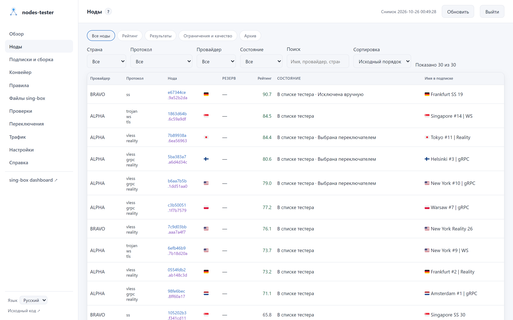
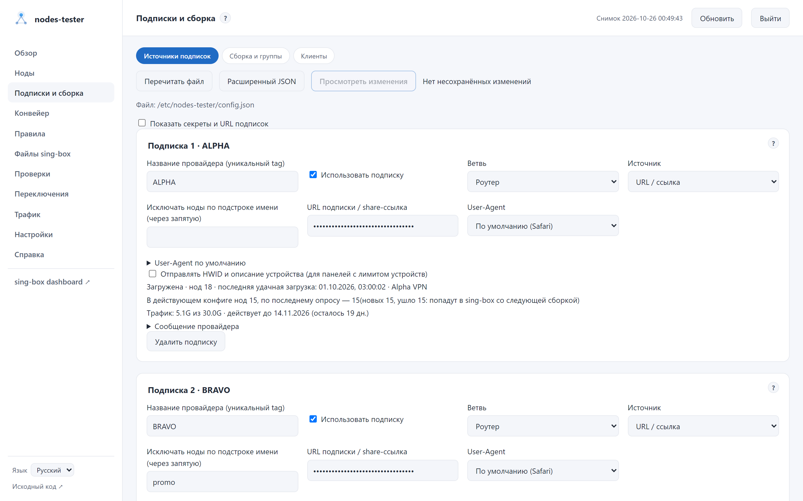
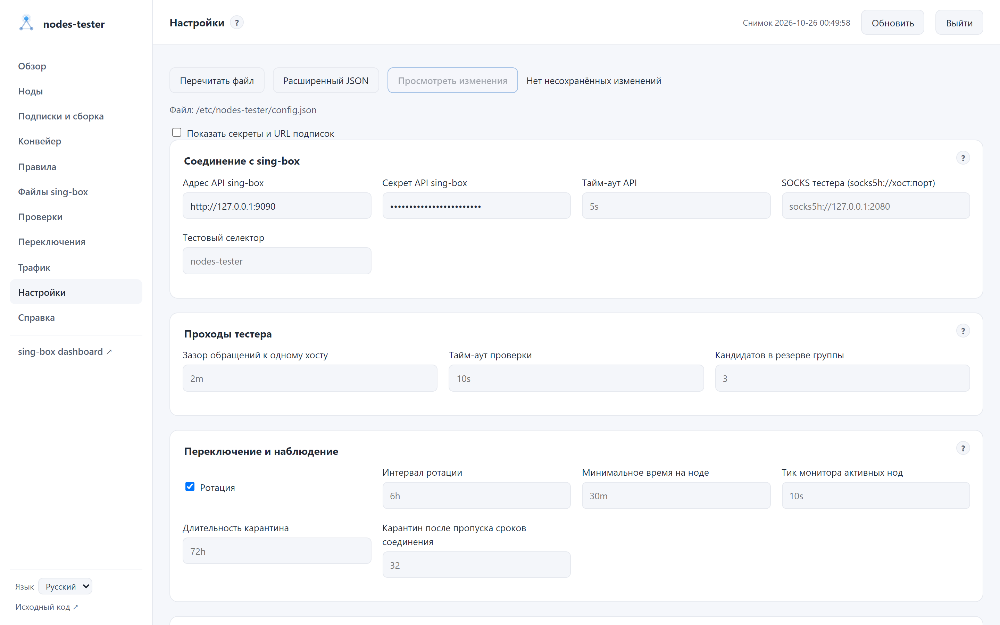
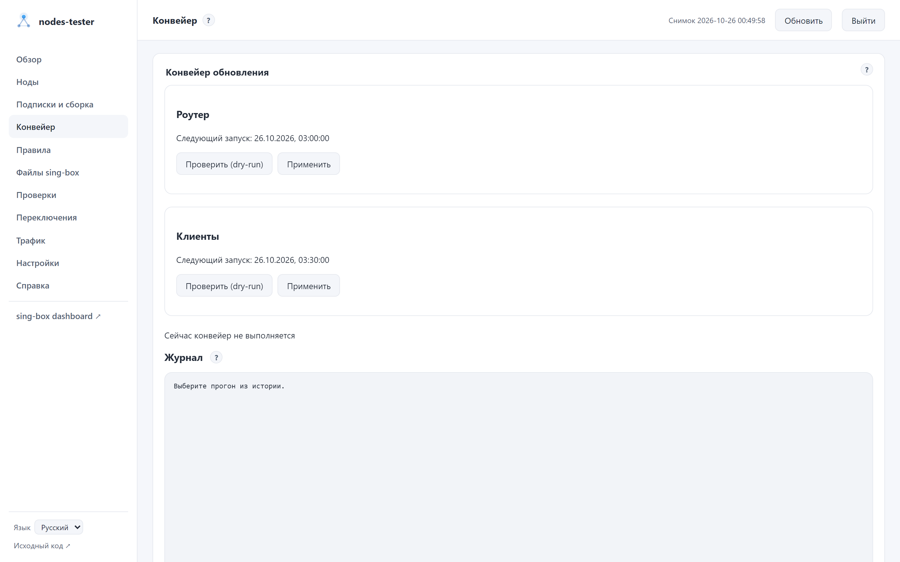
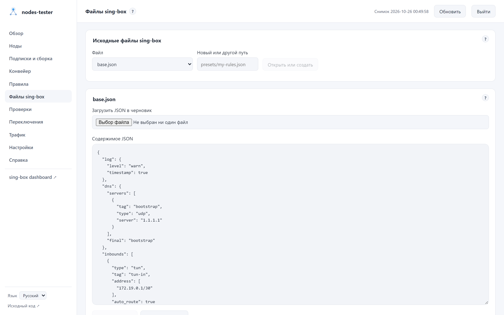
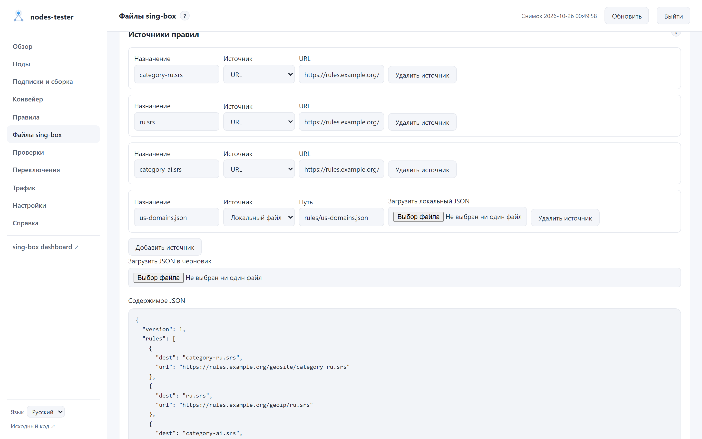
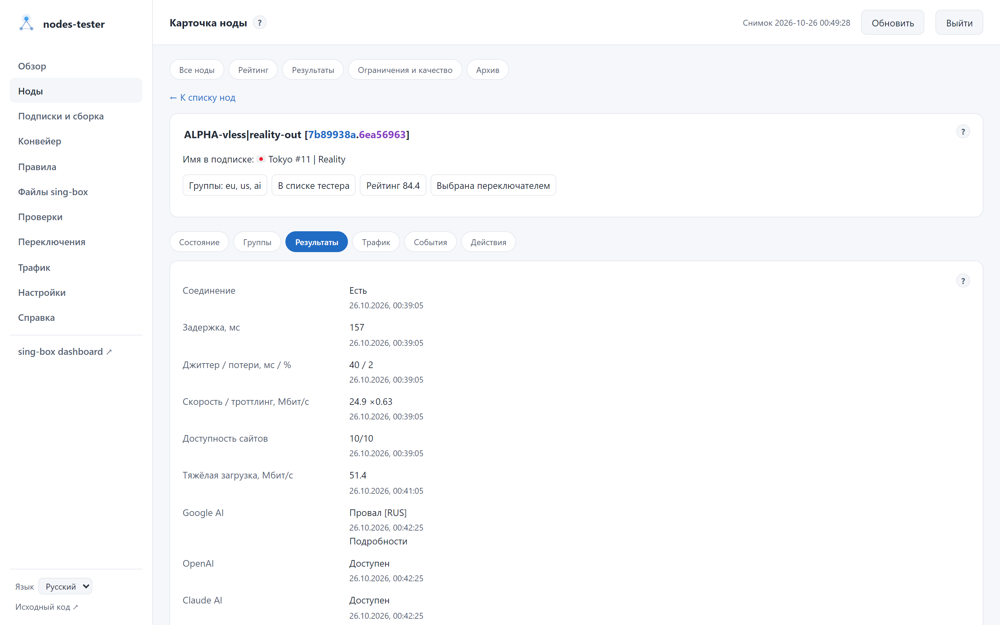
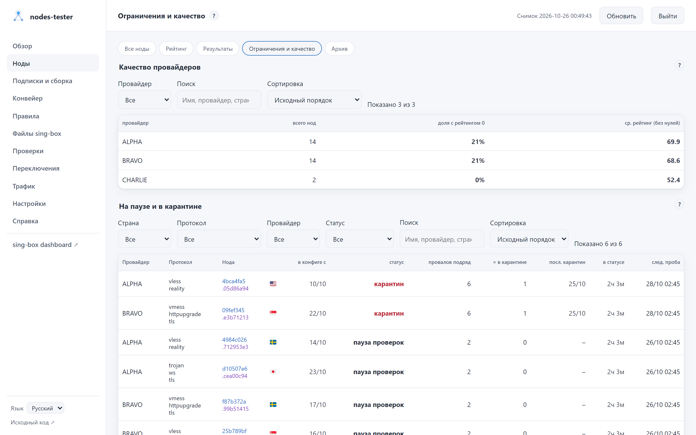

[English](USAGE.md) | **Русский**

# Админка и повседневная работа

[О проекте](../README.ru.md) · [Первый запуск на OpenWrt](../openwrt/README.ru.md) · [Справка](help/README.ru.md)

Это руководство — обзор. Каждая страница и каждый блок админки, с блок-схемами алгоритмов, описаны в
[справке](help/README.ru.md); в админке она открывается иконкой **?** рядом с заголовком страницы или в углу блока.

Руководство относится к пакету [`v0.14.0`](https://github.com/ancored/nodes-tester/releases/tag/v0.14.0). Обновление исходников на компьютере не обновляет установленный пакет.

<picture>
  <source media="(prefers-color-scheme: dark)" srcset="screenshots/ru/nodes.png">
  <source media="(prefers-color-scheme: light)" srcset="screenshots/ru/nodes-light.png">
  
</picture>

Скриншоты обновлены для версии 0.11.0, включая [группы, клиентов, пресеты и действия с нодой](screenshots/README.ru.md#группы-правила-и-действия). Полная галерея доступна в [`docs/screenshots`](screenshots/README.ru.md).

## Где что искать

| Задача | Раздел |
|---|---|
| Проверить состояние базы, тестера и выбор групп | Обзор |
| Найти ноду, понять ограничения, посмотреть измерения или выполнить действие | Ноды, затем карточка |
| Сравнить рейтинг, результаты и качество провайдеров | Подразделы «Нод» |
| Настроить источники и узнать, как применить их | Подписки и сборка |
| Запустить обновление, настроить расписание, открыть журнал | Конвейер |
| Включить пресет, проверить сборку и применить базу с правилами | Правила |
| Изменить базу sing-box, правила или клиентские файлы | Файлы sing-box |
| Запустить тестирование, посмотреть этап тестера и журнал | Проверки |
| Разобрать историю выбора групп | Переключения |
| Посмотреть пользовательский трафик за сохранённый период | Трафик |
| Настроить API sing-box, SOCKS, тесты, переключение, хранение и обслуживание базы | Настройки |
| Открыть официальную панель API-сервиса sing-box | sing-box dashboard (последний пункт меню) |

Поиск, сортировка, фильтры и страницы таблиц сохраняются в адресе. Автообновление не сбрасывает их. Карточка ноды связана с результатами и событиями по ключу `node_crc.cred_crc`, поэтому переименование тега не разрывает историю; части ключа показаны разными цветами — настройки сервера и учётные данные.

Интерфейс — на английском и русском. По умолчанию он следует языку браузера; выбор в списке «Язык» внизу меню запоминается на устройстве.

## Доступ

Нажмите «Войти для управления» и введите токен из `admin.token` рабочего `config.json`. При установке пакета он создаётся автоматически. Это не секрет API sing-box. Админка проверит токен на сервере; одного ввода строки недостаточно для доступа к действиям.

Токен хранится только до закрытия страницы, если не включить «Запомнить на этом устройстве». Эта опция сохраняет его в localStorage. «Выйти» удаляет сохранённый токен и закрывает редактор. Не включайте запоминание на чужом компьютере; используйте доверенную сеть или HTTPS, не выставляйте админку напрямую в интернет.

Пункт меню «sing-box dashboard» открывает официальную панель API-сервиса sing-box в новой вкладке. Админка отдаёт её статику с `{api.url}/dashboard/` по адресу `/sing-box-dashboard/`, поэтому у API-сервиса должен быть задан `dashboard`. После входа администратора админка сама записывает адрес и секрет `api` в настройки панели в браузере, и панель открывается без ввода секрета. Без входа панель спросит адрес и секрет сама. Секрет попадает в localStorage браузера; на чужом компьютере не входите или удалите сервер в настройках панели.

MCP-клиент подключается к `http://<роутер>:8088/mcp` с заголовком `Authorization: Bearer <admin.token>` и получает
состояние, ноды, журналы, базу и те же действия, что в админке; инструменты и настройка клиента — в
[`dashboard`](../dashboard/README.ru.md#mcp).

Отдельный `python3 -m dashboard` читает БД и позволяет редактировать файлы по токену, но не управляет Runner, не запускает тестирование и не показывает живой журнал. Админка сообщает этот режим отдельно.

## Настройки и подписки

Все настройки хранятся в одном файле `config.json` (описание полей — [CONFIG.md](CONFIG.ru.md)). Его
редактируют две страницы: «Подписки и сборка» и «Настройки». Длительности пишутся строками, как в
sing-box: `30s`, `5m`, `3h`, `2d`. Пустое поле — значение по умолчанию: оно показано серым и в файл
не пишется.

«Настройки» содержит формы подключения к sing-box, тестера, ротации и монитора, админки и
хранения, уведомлений и типа выходного IP. Блок «Обслуживание базы» под ними показывает размер
базы, последний `VACUUM` (когда, размер до и после) и следующий запуск по расписанию
`storage.vacuum`, в нём есть кнопка «Выполнить сейчас». Остальные поля доступны в расширенном JSON.

«Подписки и сборка» разделена на ветви «Роутер» и «Клиенты». Во вкладке «Источники подписок» —
подписки ветви: URL/happ, файл, папка AWG, Amnezia Premium (файлы стран выпускает и меняет тестер, см.
[CONFIG.md](CONFIG.ru.md#amnezia-premium)) или свои ноды (outbound-ы sing-box), поле «Ветвь»
(роутер, клиенты или обе) и исключение нод по подстроке имени. URL и секреты скрыты по умолчанию.
Во вкладке «Сборка и группы» — расписание и фильтры ветви, параметры групп sing-box и, для роутера,
группы с проверками и регионы.

Группа — селектор `{tag}-auto-out`, в котором все ноды; активную ноду выбирает тестер. Под настройками группы показано её текущее состояние: активная нода или запасной выход, число кандидатов, резерв. То же — в блоке «Группы» на «Обзоре», а вкладка «Группы» карточки ноды показывает по каждой группе, кандидат ли нода, и вердикты проверок с возрастом результата. Для каждой
проверки (страна выхода, тип IP, совпадение страны по базам, Google AI, OpenAI, Claude, тяжёлая
загрузка) группа указывает «обязательна», «желательна» или «не учитывать». Нода без свежего успеха
обязательной проверки не может стать активной; желательные поднимают ноду в очереди. Строгая группа
без подходящей ноды блокирует свой трафик (`block-out`), нестрогая переходит на `failsafe-out`.

XHTTP и AWG рассчитаны на `sing-box-lx`. Обычное ядро не примет созданный для них конфиг. Для
обычного sing-box исключите протоколы `xhttp` и `wg` в фильтрах ветви. Подробности приведены в
[руководстве по совместимости](SING_BOX_COMPATIBILITY.ru.md).

Перед сохранением нажмите «Просмотреть изменения», проверьте список полей и подтвердите запись. Кнопка показывает список полей; проверка содержимого на сервере происходит при сохранении. Если файл изменили в другом окне или по SSH, сохранение будет отклонено до перечитывания. Навигация, перечитывание и закрытие страницы предупреждают о несохранённом черновике; черновик не является резервной копией.

После сохранения админка на OpenWrt сама перезапускает тестер и сообщает, когда он снова ответил: на несколько секунд останавливаются мониторинг и прогон, соединения пользователей не рвутся. Пока идёт конвейер, перезапуска не будет — админка попросит сделать его позже. Вручную:

```sh
/etc/init.d/nodes-tester restart
```

У каждой подписки показано состояние последней загрузки: число нод, время последней удачной загрузки, ошибка, а также разница с действующим конфигом: сколько нод подписки в sing-box сейчас и сколько даст следующая сборка (новые и ушедшие доступы). Если панель присылает метаданные, видны название, израсходованный трафик, срок действия и сообщение провайдера. HWID роутера для панелей с лимитом устройств указан под списком подписок; happ-подписки отправляют его всегда, URL-подписки — с флажком «Отправлять HWID». Для ссылок `happ://crypt…` нужны ключи приложения Happ: они в nodes-tester не входят и скачиваются из источника на панели «Ключи Happ» (по умолчанию — `src/keys.rs` проекта hpwnr на GitHub). Источник можно заменить своим URL или путём к файлу на роутере.

Сохранение не скачивает подписки и не применяет конфигурацию к sing-box. После изменения подписок, фильтров или списка групп откройте «Конвейер», выполните проверку ветки, прочитайте журнал и примените результат. Если встроенный конвейер недоступен, используйте команды на роутере из раздела ниже. Изменения проверок групп, рейтинга и переключения пересборки не требуют: их применяет перезапуск тестера. Изменения клиентской ветки применяются запуском режима «Клиенты» и не затрагивают sing-box роутера.

<table>
  <tr>
    <td width="50%">
      <picture>
        <source media="(prefers-color-scheme: dark)" srcset="screenshots/ru/subscriptions.png">
        <source media="(prefers-color-scheme: light)" srcset="screenshots/ru/subscriptions-light.png">
        
      </picture>
    </td>
    <td width="50%">
      <picture>
        <source media="(prefers-color-scheme: dark)" srcset="screenshots/ru/config.png">
        <source media="(prefers-color-scheme: light)" srcset="screenshots/ru/config-light.png">
        
      </picture>
    </td>
  </tr>
  <tr>
    <td><strong>Подписки и сборка</strong>: источники и проверка изменений.</td>
    <td><strong>Настройки</strong>: подключение, проверки, автоматика и хранение.</td>
  </tr>
</table>

## Как обновляются подписки и конфиги

Роутерная ветка выполняет шаги по порядку:

1. Загружает подписки ветви `router` из `config.json` в `<data_dir>/raw/router.json`. Если источник временно недоступен, загрузчик может сохранить его последние исправные ноды (last-good). Защита `min_ratio` не даёт заменить raw-файл резко сократившимся набором: конвейер продолжает работу с прежним raw и отмечает это в журнале.
2. Собирает `<data_dir>/nodes.json` по разделам `pipeline.router` и `groups`. Затем обновляет правила из `singbox/rules.json`: двоичные `.srs` скачивает по URL, локальные JSON-источники берёт из `singbox/rules/`.
3. Объединяет фрагмент с `singbox/base.json` и проверяет кандидат командой `sing-box check`. Ошибка оставляет рабочий конфиг на месте.
4. Заменяет итоговый конфиг и перезапускает sing-box, только если итоговый файл изменился. Изменённые `.srs` и локальные source-наборы sing-box версии 1.10 и новее перечитывает без перезапуска. Проверка связности после применения возвращает предыдущий конфиг, если рабочая группа не отвечает.

На время роутерного применения тестер приостанавливает проверки и переключение. После завершения конвейера пауза сохраняется ещё 120 секунд. При работе через тот же прокси перезапуск sing-box может ненадолго прервать доступ к админке и SSH.

Клиентская ветка подписки не загружает: их все загружает ветка роутера, а тестер проверяет и ноды клиентских подписок (в sing-box роутера они есть только в селекторе тестера). Клиентская ветка берёт из `nodes.json` ноды, прошедшие на роутере проверки клиентских групп, собирает `whnodes.json` и объединяет его с базами `singbox/clients/base_<name>.json` [клиентов](help/subscriptions.ru.md#clients) и включёнными клиентскими пресетами `singbox/clients/presets/` (клиент без базы получает свой готовый файл из `singbox/clients/publish/` как есть). Каждый конфиг перед публикацией проходит `sing-box check`. Готовые файлы попадают в `/etc/sing-box-clients/<name>.json` и `by-token/<токен>.json`; настроенный отдельно веб-сервер раздаёт `by-token/` клиентам по ссылкам (пример — в [руководстве по скриптам роутера](../scripts/router/README.ru.md#clients)). Список клиентов и токены правятся в «Подписки и сборка» → «Клиенты». Клиентская ветка не перезапускает роутерный sing-box.

## Конвейер

После входа с токеном откройте «Конвейер», выберите ветку `router` или `clients` и нажмите «Проверить» (`--dry-run`). Проверка скачивает источники и пишет промежуточные файлы в каталог данных. Для роутера она собирает кандидат и выполняет `sing-box check`, но не обновляет правила, не заменяет рабочий конфиг и не перезапускает sing-box. Для клиентов результат пишется отдельно, без публикации; подписки клиентская проверка тоже не берёт — она собирает по текущему `nodes.json` и данным тестера. Изучите журнал, затем нажмите «Применить» или выполните на роутере:

```sh
nodes-tester pipeline router --dry-run
nodes-tester pipeline router
nodes-tester pipeline clients --dry-run
nodes-tester pipeline clients
```

В этом же разделе задаётся время суток для каждой ветки по часам роутера (`pipeline.router.at`, `pipeline.clients.at`). Оба задания изначально выключены. Для запуска каждые три часа укажите `00:00, 03:00, 06:00, 09:00, 12:00, 15:00, 18:00, 21:00`. После включения новое расписание действует со следующего времени запуска. При перезапуске тестера пропущенное задание выполняется один раз. Одновременно может идти только один конвейер, в том числе при запуске из терминала. Без встроенного расписания конвейер можно запускать из cron (`nodes-tester pipeline router` в `/etc/crontabs/root`), но не одновременно с ним.

История показывает ветку, ручной или плановый запуск, начало, конец и результат; откройте запись для полного журнала. Значение `ok` означает успех, `error` сообщает об ошибке, `busy` показывает занятость конвейера (код 75), `timeout` указывает на превышение времени. Статус `interrupted` появляется, если после сбоя процесса нет подтверждённого кода завершения. Лимит времени — `pipeline.timeout`, по умолчанию `30m`. Подписки роутера опрашиваются чаще сборки: `pipeline.fetch.every` (по умолчанию `3h`, `0s` — выключить; поле «Опрашивать подписки роутера каждые» в «Подписках и сборке») обновляет только сырые ноды и состояние подписок — sing-box не трогается; в истории такие запуски отмечены как «опрос подписок». Плановая сборка, наступившая во время опроса, дожидается его окончания. Журналы лежат в `<data_dir>/pipeline/runs/`, история хранится в `<data_dir>/pipeline.db`. Храните `data_dir` на постоянном носителе.

<picture>
  <source media="(prefers-color-scheme: dark)" srcset="screenshots/ru/pipeline.png">
  <source media="(prefers-color-scheme: light)" srcset="screenshots/ru/pipeline-light.png">
  
</picture>

Тестер проверяет ноды, у которых истёк срок годности тестов. «Запустить тестирование сейчас» в разделе «Проверки» проверяет все доступные тестеру ноды, не дожидаясь сроков; эта кнопка не обновляет подписки. Пока тестирование по запросу идёт, повторный запрос недоступен.

## Файлы sing-box

В разделе «Файлы sing-box» загрузите или отредактируйте `base.json`, `rules.json`, локальные `rules/*.json` и клиентские базы `clients/base_alice.json`, `clients/base_bob.json`. Перед записью `base.json` сервер объединяет его с существующим `nodes.json` и выполняет `sing-box check`; сначала соберите `nodes.json`, если его ещё нет. `rules.json` задаёт, какие правила обновлять: двоичные `.srs` допускаются только по HTTP(S) URL, а локальный источник должен быть JSON-файлом в формате source rule-set из `rules/`. Готовые файлы в `clients/publish/` публикуются без сборки.

Редактор показывает прошлые версии файла и позволяет восстановить выбранную. Перед сохранением он проверяет, не изменился ли файл после открытия страницы. Сохранение исходника не запускает конвейер: проверьте нужные ветки через dry-run и примените их отдельно. При изменении только правил перезапуск для sing-box 1.10 и новее не нужен; на старом ядре новые локальные rule-set будут прочитаны при следующем перезапуске.

<table>
  <tr>
    <td width="50%"><picture><source media="(prefers-color-scheme: dark)" srcset="screenshots/ru/singbox.png"><source media="(prefers-color-scheme: light)" srcset="screenshots/ru/singbox-light.png"></picture></td>
    <td width="50%"><picture><source media="(prefers-color-scheme: dark)" srcset="screenshots/ru/singbox-rules.png"><source media="(prefers-color-scheme: light)" srcset="screenshots/ru/singbox-rules-light.png"></picture></td>
  </tr>
  <tr><td>База, клиентские файлы и история версий.</td><td>Источники правил и локальные JSON-файлы.</td></tr>
</table>

## Правила sing-box

Схема сборки итогового конфига: [CONFIG_ASSEMBLY.md](CONFIG_ASSEMBLY.ru.md).

Правила маршрутизации и DNS собираются из пресетов — отдельных файлов `presets/*.json` в
«Файлах sing-box». Пресет содержит всё, чего нет в базе: свои правила маршрута и DNS,
DNS-серверы и наборы правил. Например, пресет `zone-us` направляет пользователя `us` и домены
`us-domains` в выход `us-out`, а их DNS — в `dns-us`; выход `us-out` объявляет пресет `out-us`
из группы `us-auto-out`. Для работы нужны группа `us` и inbound с пользователем `us` в базе.

Раздел «Правила» показывает пресеты по приоритету: название, описание, нужные группы и
переключатель. При переключении сервер собирает итоговый конфиг из базы, `nodes.json` и
включённых пресетов и выполняет `sing-box check`; если проверка не прошла, файл не
меняется, а причина показывается на странице. Работающий sing-box меняет только кнопка
«Применить»: она копирует базу, собирает конфиг, перезапускает sing-box при изменениях и
проверяет связность; журнал выводится на странице. «Проверить сборку» делает то же без
изменений. При возврате на страницу она показывает статус и журнал последнего прогона
`apply`; полная история — в «Конвейере».

Вкладка «Клиенты» в том же разделе показывает пресеты `singbox/clients/presets/` — общие для
всех включённых клиентов. Переключатель проверяет конфиг каждого клиента (база,
`whnodes.json`, включённые пресеты) через `sing-box check`. «Собрать клиентов» публикует конфиги
по текущему `whnodes.json`, не загружая подписки (`nodes-tester pipeline apply-clients`);
«Проверить сборку» собирает их в отдельный каталог без публикации. Локальные наборы правил
пресетов клиент получает по адресу раздачи: задайте его в `clients/settings.json`
(`{"rules_url": "https://…/"}`), иначе такой пресет не соберётся; подробности — в
[сборке конфига](CONFIG_ASSEMBLY.ru.md#пресеты-клиентов).

Порядок правил задаёт `priority` (меньше — выше); `priorities` переопределяет его для
отдельного пути, например `{"dns.rules": 150}` ставит DNS-правила пресета в другое место.
Пресет может содержать любые разделы конфига и сам объявляет нужные ему DNS-серверы и наборы
правил: одинаковые объекты из разных пресетов схлопываются, а тот же тег с другим содержимым
— ошибка. Метаданные хранятся в ключе `_preset` и в итоговый конфиг не попадают. Как идёт
склейка — в [`CONFIG_ASSEMBLY.md`](CONFIG_ASSEMBLY.ru.md#склейка). Готовые пресеты — в
`/usr/share/nodes-tester/examples/singbox/presets/`, их каталог — в
[библиотеке пресетов](CONFIG_ASSEMBLY.ru.md#библиотека-пресетов).

## Как читать состояние и действовать

Страна в таблицах показана флагом, код — во всплывающей подсказке. В «Результатах» колонка «IP» показывает значком, кому принадлежит выходной IP ноды: здание — дата-центр, телефон — мобильная сеть, дом — домашний провайдер; маска — IP известен как VPN или прокси. Флаг под значком — база относит IP к другой стране, чем показал тест соединения. Красные значки хуже для AI-сервисов; наведите курсор, чтобы увидеть IP и сеть. Последние колонки — Google AI, OpenAI и Claude AI: галка — сервис доступен, крест — нет, «?» — сбой сети, действует прошлый результат; под отметкой Google AI — страна, которой Google видит ноду. Протокол показан по частям, каждая на своей строке.

На «Обзоре» блок «sing-box» показывает, работает ли sing-box, и позволяет его остановить и запустить. Остановка — аварийный выход, если sing-box сломал сеть. Что будет с устройствами LAN, зависит от службы killswitch роутера: если она загружена, защищённые её правилами устройства остаются без интернета, пока sing-box не запустят; без неё трафик идёт напрямую через провайдера. Блок показывает, загружены ли правила killswitch и сколько пакетов отбито, и позволяет включить или выключить службу. Пока sing-box остановлен из админки, конвейер не применяет новый конфиг. Уведомления в Telegram или webhook настраиваются в «Настройках».

Таблицы фильтруются выпадающими списками: страна, группа, протокол, провайдер и поля конкретной таблицы (состояние, статус, причина). Группы берутся из текущего `nodes.json`: в каждой группе все ноды, активной нода становится по проверкам группы. Список тестера, качество, ограничения и выбор переключателя показывают разные стороны состояния ноды. Отсутствие замеров не означает провал. Рейтинг оценивается по шкале от 0 до 100, его факторы нормированы от 0 до 1; физические значения смотрите в результатах с датой собственного замера. «Результаты» показывают последний результат каждого теста, время замеров — в карточке ноды.

«Все ноды» — ноды текущих подписок роутера. Новые ноды появляются в течение минуты после применения конфига, без замеров, и тестер сразу проверяет их. Ушедшие из подписок ноды остаются только в «Архиве»; их карточка открывается оттуда. Столбец «Имя в подписке» и карточка показывают исходное имя ноды у провайдера; прочерк — имени нет (например, AWG из файлов).

В карточке ноды доступны действия с подтверждением:

- «Исключить»: бессрочно пропускать следующие проверки до снятия исключения. Это не удаление из подписки и не немедленная смена текущего селектора.
- «В карантин»: отложить проверки на настроенный срок `selection.quarantine.duration`.
- «Снять ограничение»: вернуть ноду в очередь проверки. Это не подтверждает исправность ноды.
- «Выбрать в группе»: сделать ноду активной в выбранной группе сейчас. Список содержит только группы, где нода — допустимый кандидат (положительный рейтинг, пройденные обязательные тесты группы, нет ограничений). Автоматика продолжает работать и впоследствии может изменить выбор.

Обзор отражает состояние переключателя, не независимую проверку селекторов sing-box. История содержит последние 200 записей с датой, группой, причиной и предыдущей нодой; значок у причины различает аварийную замену, аварию без замены, смену по качеству, ротацию, первый и ручной выбор, failsafe. Последняя запись группы не обязательно показывает её текущую активную ноду; авария без замены не считается успешным переключением.

Пользовательский трафик показан за доступный сохранённый период; тестовый трафик из него исключён. Отдельный блок показывает расход тестера за последние 24 часа: измеренные байты загрузочных тестов и выборку живых соединений. Эти показатели могут пересекаться, поэтому складывать их нельзя. Агрегаты по провайдерам, странам, протоколам и нодам строятся из всех сохранённых строк и фильтруются по стране, группе, протоколу и провайдеру; топ назначений содержит до 50 строк. Счётчики назначений накопительные. Журнал можно приостановить и отфильтровать; после длинной паузы часть старых строк может исчезнуть из серверного буфера.

<table>
  <tr>
    <td width="50%">
      <picture>
        <source media="(prefers-color-scheme: dark)" srcset="screenshots/ru/node-card.png">
        <source media="(prefers-color-scheme: light)" srcset="screenshots/ru/node-card-light.png">
        
      </picture>
    </td>
    <td width="50%">
      <picture>
        <source media="(prefers-color-scheme: dark)" srcset="screenshots/ru/lifecycle.png">
        <source media="(prefers-color-scheme: light)" srcset="screenshots/ru/lifecycle-light.png">
        
      </picture>
    </td>
  </tr>
  <tr>
    <td><strong>Карточка ноды</strong>: свежесть измерений, трафик, события и действия.</td>
    <td><strong>Ограничения и качество</strong>: пауза, карантин и состояние провайдеров.</td>
  </tr>
</table>

## Если что-то не работает

| Симптом | Что проверить |
|---|---|
| Админка не открывается | Сервис, `admin.enabled`, адрес/порт, LAN-доступ, `logread -e nodes-tester` |
| Токен не принимается | Токен действующего конфига; после изменения нужен перезапуск |
| База отсутствует или отключена | Путь `storage.path`, запуск тестера |
| Ошибка чтения или старые данные | Ошибку в шапке; устаревший снимок не подтверждает текущее состояние |
| Нет замеров | Тестовый selector, журнал |
| Новых нод нет после сохранения | Выполнены ли загрузка, сборка и применение к sing-box |
| Конвейер занят, код 75 | Дождитесь текущего запуска; проверьте историю и журнал. Одновременный запуск заблокирован |
| `timeout` | Проверьте последнюю стадию в журнале и лимит `pipeline.timeout`; оркестратор завершает группу процессов после защитного ожидания |
| Ошибка `sing-box check` | Проверьте базу, итоговый кандидат и совместимость протоколов с установленным ядром. Рабочий конфиг не заменён |
| После применения пропала связность | Прочитайте журнал проверки и отката. Конвейер возвращает предыдущий конфиг, если запрос через рабочую группу не проходит |
| Выбор в группе недоступен | Проверенный токен, встроенный Runner, switching, нода — кандидат хотя бы одной группы |

Перед обновлением пакета используйте `nodes-tester backup --stable`. Если нужна предыдущая версия, проверьте снимок командой `nodes-tester rollback --check`, затем выполните `nodes-tester rollback`. Порядок и состав снимка описаны в [инструкции по обновлению](../openwrt/README.ru.md#6-обновить-пакет).

В [Issues](https://github.com/ancored/nodes-tester/issues) укажите версии OpenWrt, пакета и sing-box, действие и короткую обезличенную ошибку. Удалите URL подписок, ключи, токены и приватные адреса.
