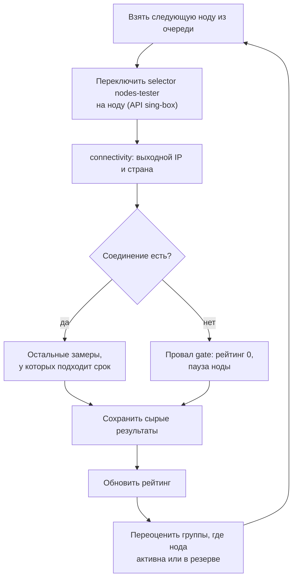
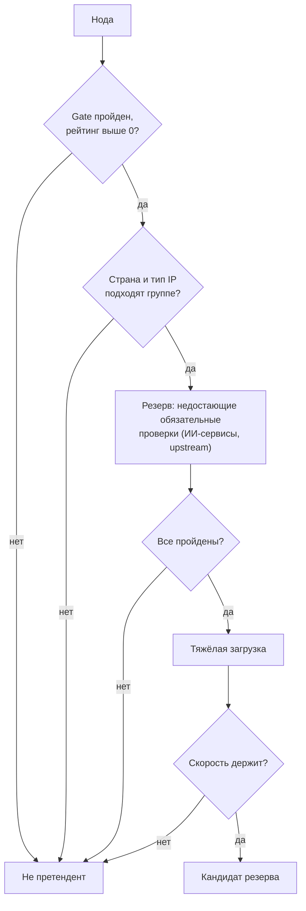
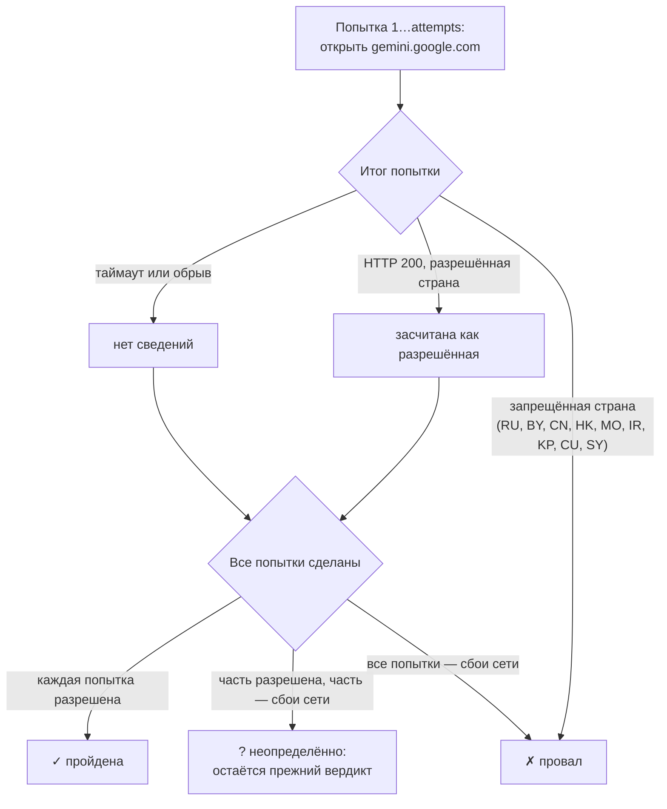

[English](checks.md) | **Русский**

# Тесты и проверки

Всё о ноде тестер узнаёт, пропуская через неё настоящий трафик. Результаты бывают двух видов:

- **замеры** (тесты) дают числа — задержку, скорость, потери — и питают [рейтинг](rating.ru.md);
- **проверки** дают вердикт «да / нет / неизвестно» и решают, каким [группам](groups.ru.md) нода подходит.

У тех и других есть **срок жизни** (`ttl`): свежему результату доверяют, просроченный повторяют. «Проходов» по всем нодам нет:
каждый результат истекает сам по себе, и тестер всегда занят тем, что истекло.

## Как проверяется одна нода

Тестер никогда не подключается к ноде напрямую. Он переключает свой selector `nodes-tester` в работающем sing-box на ноду через
API-сервис sing-box и отправляет тестовые запросы через SOCKS-inbound `tester.socks`. Так замеры идут ровно тем путём, каким идёт
трафик пользователей.

- `connectivity` всегда идёт первым. Без соединения остальные замеры бессмысленны и не выполняются.
- За один визит выполняется каждый замер ноды, до срока которого осталось меньше его разброса, так что визит обычно обновляет
  сразу несколько результатов.
- Замер, попавший на перезапуск sing-box (конвейер применяет конфиг, обновляется ядро), не засчитывается: тестер замечает, что API
  sing-box перестал отвечать или сменился процесс, ждёт минуту и повторяет.
- Нода, исчезнувшая из селектора между очередью и визитом, пропускается без провала.

## Сроки жизни результатов и очередь

Каждый замер живёт `tests.<имя>.ttl` (3 часа по умолчанию), каждая проверка — `checks.<имя>.ttl` (от 6 до 24 часов). Срок
укорачивается на случайную долю `ttl_jitter` (десятая часть `ttl` по умолчанию). Доля постоянна для ноды, поэтому ноды, проверенные
подряд, истекают в разное время и не возвращаются пачкой.

Порядок очереди:

1. Новая нода без замеров проверяется сразу.
2. Активные ноды групп и кандидаты резерва с истёкшими замерами.
3. Все остальные ноды, начиная с самого старого результата.
4. При равных сроках первой идёт нода хоста, к которому дольше всех не обращались.

Если очередь не успевает за `ttl` (много нод, медленные ноды), каждая нода всё равно обновляется раз за полный круг, а активные и
кандидаты — по своим срокам.

### Паузы между обращениями к одному хосту

Ноды одного хоста (разные доступы, порты, протоколы одного сервера) проверяются с промежутком не меньше `tester.host_gap` (2 минуты по
умолчанию). Частые подключения к одному серверу с одного адреса разными протоколами выглядят подозрительно для провайдеров и DPI и
ведут к блокировкам.

### Тестирование по требованию

Кнопка «Запустить тестирование сейчас» на странице [«Проверки»](runs.ru.md) ставит в очередь все ноды, не дожидаясь сроков. Она не
скачивает подписки и не меняет конфигурацию. Пока идёт тестирование по требованию, второй запрос не принимается; страница показывает,
сколько нод осталось.

## Замеры

| Тест | Что делает | Результат |
|---|---|---|
| `connectivity` | запрашивает `https://www.cloudflare.com/cdn-cgi/trace` через ноду | выходной IP, страна выхода, дата-центр Cloudflare; это **gate**: без него нода считается мёртвой |
| `latency` | один запрос, время до первого байта (TTFB) | задержка, мс |
| `jitter` | несколько запросов подряд (`samples`, 5 по умолчанию, через `interval`) | средняя, минимальная, максимальная задержка, джиттер, потери % |
| `download` | качает файл до `duration` (20 с), по умолчанию 5 МБ с Cloudflare | скорость Мбит/с; троттлинг (скорость последнего окна в 2 МБ к первому); удержание (доля полученного файла) |
| `reachability` | параллельно открывает несколько сайтов (по умолчанию Google, Cloudflare, YouTube) | сколько из них ответило |

Адреса, размеры и таймауты задаются в разделе `tests` ([справочник](../CONFIG.ru.md#tests)). Для нод с выходом в регионе можно задать
свои адреса (`for_region`): например, серверы замера скорости в России для российских выходов.

Отказ тестового сервера (HTTP 429, 5xx) — не вина ноды: такой замер помечается как ограниченный и нейтрален для рейтинга. Обрыв
соединения или таймаут засчитываются против ноды.

### Страна выхода

Страна ноды — только та, которую измерил `connectivity`: страна выходного IP, как её видит Cloudflare. Имя, которое провайдер дал
ноде (с флагом или городом), не используется: провайдеры часто называют ноды по стране рекламы, а не выхода. Измеренная страна также
выбирает адреса тестов (`for_region`).

Если последнее соединение не удалось, админка показывает прежнюю страну бледным флагом со временем того замера.

## Проверки

Проверка отвечает на один вопрос о ноде. Группы ссылаются на проверки по имени: в `require` (обязательные) или в `prefer`
(желательные). Страна выхода, тип IP и вердикт белых списков известны для каждой ноды; ИИ-проверки, `upstream` и `heavy` выполняются
только для групп, которые их используют.

| Проверка | Вопрос | Кто выполняет и как часто |
|---|---|---|
| `country` | Страна выхода разрешена для группы? | замер `connectivity`; `ttl` 24 ч |
| `ip_type` | Какой выходной IP: домашний, мобильный, дата-центр, известный прокси? | тестер раз в 5 минут для новых выходных IP (ip-api.com); `ttl` 24 ч |
| `geo_consistent` | Совпадает ли страна IP по базам с измеренной? | вместе с `ip_type` |
| `gemini` | Пускает ли Google Gemini и из какой страны Google видит ноду? | [резерв](groups.ru.md#reserve); `ttl` 24 ч |
| `openai` | Пускает ли OpenAI? | резерв; `ttl` 24 ч |
| `anthropic` | Пускает ли Claude (Anthropic)? | резерв; `ttl` 24 ч |
| `upstream` | Работает ли через ноду вышестоящий прокси? | резерв; `ttl` 6 ч |
| `heavy` | Держит ли нода скорость на долгой тяжёлой загрузке? | резерв; `ttl` 6 ч |
| `whitelist` | Прошла бы нода режим белых списков мобильного интернета в России? | тестер раз в 5 минут, локально; `ttl` 24 ч |

Вердикт проверки в админке: ✓ пройдена, ✗ провалена, ? нет свежего результата (не проверялась, истекла или во время проверки сбоила
сеть).

### Сначала дешёвые проверки

ИИ-проверки и тяжёлая загрузка стоят времени и трафика, поэтому выполняются только для нод, уже прошедших дешёвые: gate, страну выхода и
тип IP, которых требует группа. Их выполняет процесс резерва группы, а не обычная очередь (см. [резерв](groups.ru.md#reserve)).

### Тип выходного IP и страна по базам

Раз в 5 минут тестер собирает выходные IP без свежих данных и спрашивает о них ip-api.com одним пакетным запросом. Ответ даёт
владельца сети (ASN), признаки дата-центра, мобильной сети и известного прокси/VPN и страну IP по базе. Запрос идёт через SOCKS
тестера на лучшей здоровой ноде (DNS-фильтры на роутере часто блокируют ip-api.com); при неудаче — напрямую.

- `ip_type` пройдена, если тип есть в списке разрешённых у группы (`kinds`: `residential` — домашний, `mobile` — мобильный,
  `hosting` — дата-центр). ip-api помечает прокси почти все выходы нод; признак тип не отменяет, а `proxy` в списке пропускает
  любой IP с ним. Своего `ttl` у `ip_type` и `geo_consistent` в группе нет: сведения обновляются по `checks.ip_type.ttl`.
- `geo_consistent` пройдена, если страна по базе совпадает с измеренной страной выхода. ИИ-сервисы и стриминговые сайты смотрят в
  базы: ноду, чей IP числится в другой стране, они считают той страной.

### Вход ноды и цепочки

Вход — адрес сервера ноды, к которому подключается sing-box. Раз в 5 минут тестер резолвит имена серверов нод без свежих данных
через DoH-серверы группы `bootstrap` конфига sing-box (ею sing-box резолвит домены нод; такой группы нет — через Cloudflare), только
IPv4, хранит ответ `checks.ip_type.ttl` и спрашивает ip-api.com о входных IP вместе с выходными.

Нода — цепочка, если её выходной IP не совпадает ни с одним IP входа: сервер подписки передаёт трафик дальше, часто в другую страну.
Админка показывает её как флаг входа → флаг выхода; оранжевое облако после выхода — выход через Cloudflare WARP (AS13335), страна
которого зависит от точки присутствия Cloudflare. На выбор нод цепочки не влияют.

### ИИ-сервисы

**Google Gemini** (`gemini`). Проверка `attempts` раз (3 по умолчанию) открывает gemini.google.com и читает со страницы код страны,
в которую Google поместил клиента.

Одной попытки мало: некоторые ноды выходят то по IPv4, то по IPv6 Cloudflare WARP, и Google видит то зарубежную страну, то Россию.
Страница тяжёлая, поэтому у проверки свой `timeout` (20 с).

**OpenAI** (`openai`) и **Claude** (`anthropic`) работают так же (`attempts`, `timeout`), но смотрят не на страну, а на решение самого
сервиса: `openai` запрашивает `api.openai.com/compliance/cookie_requirements` (из запрещённого региона отвечает
`unsupported_country`), `anthropic` — `api.anthropic.com/v1/models` без ключа (из запрещённого региона `forbidden`, из разрешённого
`authentication_error`). Нераспознанный ответ считается провалом.

### Вышестоящий прокси

`upstream` нужна, когда трафик уходит цепочкой: нода группы, а за ней ещё один прокси, например SOCKS-сервер со статическим IP
(`"detour": "ai-auto-out"` в sing-box). Нода может быть жива, но закрывать порт прокси, или прокси может не принимать IP ноды; тогда
цепочка мертва, хотя все остальные проверки нода проходит. Резерв подключается через ноду к серверу `checks.upstream.outbound` с его
учётными данными из рабочего конфига sing-box, запрашивает `url`, и нода проходит, только если удались все `attempts`.

### Тяжёлая загрузка

`heavy` качает большой файл (по умолчанию 20 МБ с Cloudflare, до `duration` 30 с) и проваливается, если скорость ниже `min_mbps`
(5 Мбит/с). Некоторые провайдеры и DPI пропускают короткий тест и душат долгие передачи — эта проверка их ловит. Отказ сервера
закачки (429, 5xx, 401/403/404) вердикта не даёт.

### Белые списки

`whitelist` показывает, работала бы нода, если мобильный оператор пускает только по белым спискам: IP сервера должен быть в списке IP,
а TLS-имя (SNI) — в списке доменов (домен или его поддомен); ноде без TLS достаточно IP. Списки — текстовые списки
[ru-mobile-whitelist](https://github.com/ancored/ru-mobile-whitelist).

Проверка локальная: трафик через ноду не идёт. Домен сервера разрешается DoH-запросом к серверу `checks.whitelist.dns` из рабочего
конфига sing-box, никогда не через системный резолвер роутера (он отдал бы имя ноды провайдеру). Ноды клиентских подписок тоже есть
в sing-box роутера, поэтому проверка охватывает и их, а [клиентская группа](subscriptions.ru.md#client-groups) может её требовать.

## См. также

- [Рейтинг](rating.ru.md): как замеры превращаются в оценку.
- [Группы и кандидаты](groups.ru.md): как проверки решают, где нода может работать.
- [Разделы `tests` и `checks`](../CONFIG.ru.md#tests) справочника.
