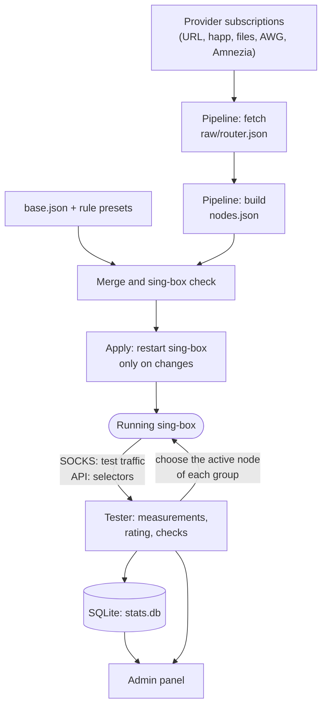
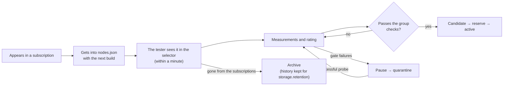

**English** | [Русский](concepts.ru.md)

# How nodes-tester works

nodes-tester keeps a router with sing-box on working proxy nodes. It fetches the provider subscriptions,
builds the sing-box configuration from them, constantly checks every node and switches each group of
the router to the best node that fits it. This page explains the parts of the system and the terms
used everywhere in the admin panel and in this help.

<a id="big-picture"></a>
## The big picture

Two independent loops work on the router: the **pipeline** turns subscriptions into a sing-box
configuration, and the **tester** checks the nodes of the running sing-box and chooses among them.
They meet only in sing-box itself and in the files of the data directory.



- The pipeline runs by schedule or by a button on the [“Pipeline”](pipeline.md) page. It never
  measures nodes and never chooses among them.
- The tester runs all the time as a service. It does not download subscriptions and does not write the
  sing-box configuration: it works only with what sing-box already has, through two doors — the SOCKS
  inbound for test traffic and the API service for switching selectors.
- The admin panel is built into the tester process. It shows the state, edits `config.json` and the
  sing-box source files, and starts the pipeline and actions.

<a id="config"></a>
## One settings file

All settings live in one file, `config.json` (on OpenWrt `/etc/nodes-tester/config.json`): subscriptions,
groups and their checks, the tester, the rating, switching, the pipeline, the admin panel and notifications.
The [“Subscriptions and build”](subscriptions.md) and [“Settings”](settings.md) pages are two views of this
one file. Every field is described in the [config.json reference](../CONFIG.md).

Rules of the format:

- durations are strings, as in sing-box: `30s`, `5m`, `3h`, `2d`;
- an empty form field means the default value; it is shown in grey and is not written to the file;
- after saving, the tester restarts by itself: checks stop for a few seconds, user connections stay;
- subscriptions, filters and the list of groups change `nodes.json` and reach sing-box only with the next
  pipeline build.

<a id="nodes"></a>
## Nodes and their keys

A **node** is one sing-box outbound from a subscription: a server with its protocol and access
credentials. Every node gets a tag of the form

```text
{provider}-{protocol}-out [node_crc.cred_crc]
LUNA-vless|grpc|reality-out [8d31a426.0be1f7a2]
```

- **provider** — the `tag` of the subscription the node came from;
- **protocol** — the protocol and transport descriptor: `vless|reality`, `vmess|ws|tls`, `hy2`, `wg`
  (WireGuard and AmneziaWG);
- **key** `node_crc.cred_crc` — two checksums. The first is computed from the server settings (address,
  port, transport, TLS, Reality key), the second from the account credentials (UUID, password, private key).

The key is the identity of the node in the database, in the card address and in the history. When the
provider reissues the credentials, only the second part changes: the tester recognises the node by the first
part and keeps its country, check results and rating. In the admin panel the two parts are shown in
different colours: server settings and credentials.

The provider's node name (often with a country flag) is not used for anything except display: the exit
country is always measured.

**Host** — the server address of a node without the port. Several nodes of one host (different
accesses, ports, protocols) usually fail together, so the tester treats them as a unit: it spreads
requests to one host in time, keeps at most one node per host in a group reserve and does not replace an
active node with a node of the same host.

<a id="branches"></a>
## Router and client branches

The pipeline has two branches built from the same file:

| Branch | Subscriptions | Result | Where it goes |
|---|---|---|---|
| **Router** (`router`) | `branch` = `router` or `both` | `nodes.json` | the router sing-box; the tester checks these nodes |
| **Clients** (`clients`) | `branch` = `clients` or `both` | `whnodes.json` | client configs (phones, laptops) built from the client bases |

The tester measures only the router nodes. Client-branch nodes that the router does not have get only the
whitelist check and have no card (they are marked “client (WH)” in the node list).

<a id="groups"></a>
## Groups, candidates and the active node

A **group** is a sing-box selector `{tag}-auto-out` (for example `eu-auto-out`) that contains *all* router
nodes. The group settings say which nodes are allowed in it: required checks (exit country, AI services,
IP type…) and preferred ones. Routing rules send traffic to the group selector; the tester decides which node
inside it is selected.

| Term | Meaning |
|---|---|
| **candidate** | a node that may become active in the group: it passed the gate, has a rating above zero, is not restricted and has fresh successes of all required checks |
| **active node** | the node currently selected in the group selector |
| **reserve** | a few candidates checked in advance (including the expensive checks) to replace the active node at once |
| **fallback outbound** | where a group goes when it has no candidates: `failsafe-out`, `block-out` or `direct-out` |
| **global-auto-out** | a shared selector over the groups marked “Part of global-auto-out” |

Details: [Groups and candidates](groups.md), [Switching](switching.md).

<a id="lifecycle"></a>
## The life of a node



1. A node appears in a subscription and gets into `nodes.json` with the next build of the router branch.
2. Within a minute after sing-box applies the configuration, the tester sees the node in its selector, adds
   it to the database without measurements and checks it right away.
3. Measurements form the [rating](rating.md); [checks](checks.md) decide which groups may use the node.
4. Failures lead to a [pause and quarantine](restrictions.md); a successful check lifts them.
5. When the node disappears from the subscriptions and from the configuration, it moves to the
   [Archive](nodes.md#archive); its history is erased after `storage.retention` (30 days by default).

<a id="files"></a>
## Where the data lives

| What | OpenWrt package |
|---|---|
| Settings | `/etc/nodes-tester/config.json` (permissions 0600: it holds secrets) |
| sing-box sources: base, rules, presets, client bases | `/etc/nodes-tester/singbox/` |
| Fetched subscriptions | `/opt/nodes-tester/raw/router.json`, `raw/clients.json` |
| Build results | `/opt/nodes-tester/nodes.json`, `whnodes.json` |
| Measurements, rating, history | `/opt/nodes-tester/results/stats.db` (SQLite) |
| Pipeline history and logs | `/opt/nodes-tester/pipeline.db`, `pipeline/runs/` |
| Running sing-box config | `/etc/sing-box/config.json` |

The data directory is set by `data_dir` in `/etc/config/nodes-tester`. Keep it on persistent storage.

<a id="glossary"></a>
## Glossary

| Term | Meaning |
|---|---|
| Subscription | a node source: a provider URL, a `happ://` link, a file, a folder of AWG files, an Amnezia Premium link or your own outbounds |
| Pipeline | fetching subscriptions, building `nodes.json`, checking and applying the sing-box config |
| Measurement (test) | a network test of a node that feeds the rating: connection, latency, jitter, speed, reachability |
| Check | a yes/no verdict used by groups: exit country, IP type, AI services, heavy download, whitelist, upstream proxy |
| Gate | the basic condition of a node being alive; a gate failure makes the rating 0 at once |
| Rating | the node score from 0 to 100, smoothed over time |
| Lifetime (`ttl`) | how long a measurement or a check result stays fresh |
| Rotation | a scheduled change of the active node to spread the load |
| Monitor | supervision of active nodes between measurements |
| Pause / quarantine | temporary exclusion of a failing node from checks |
| Exclusion (ban) | a manual indefinite exclusion |
| Killswitch | a router service that does not let LAN devices reach the internet bypassing sing-box |
