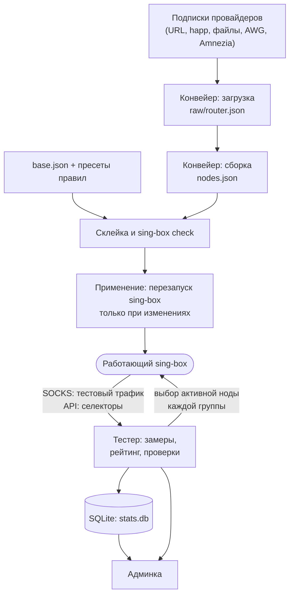
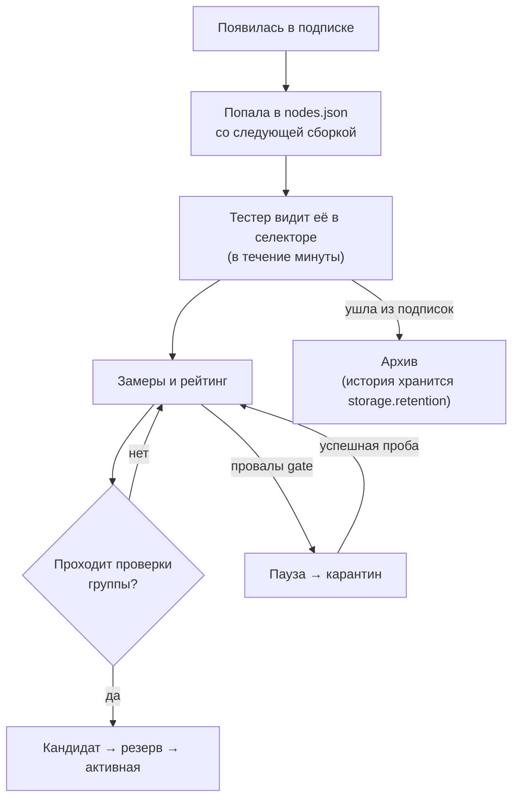

[English](concepts.md) | **Русский**

# Как устроен nodes-tester

nodes-tester держит роутер с sing-box на рабочих прокси-нодах. Он забирает подписки провайдеров, собирает из них конфигурацию
sing-box, постоянно проверяет каждую ноду и переключает каждую группу роутера на лучшую подходящую ей ноду. Эта страница объясняет
части системы и термины, которые встречаются по всей админке и в этой справке.

<a id="big-picture"></a>
## Общая картина

На роутере работают два независимых цикла: **конвейер** превращает подписки в конфигурацию sing-box, а **тестер** проверяет ноды
работающего sing-box и выбирает среди них. Встречаются они только в самом sing-box и в файлах каталога данных.



- Конвейер запускается по расписанию или кнопкой на странице [«Конвейер»](pipeline.ru.md). Он никогда не измеряет ноды и не
  выбирает среди них.
- Тестер работает постоянно, как служба. Он не скачивает подписки и не пишет конфигурацию sing-box: работает только с тем, что уже
  есть в sing-box, через два входа — SOCKS-inbound для тестового трафика и API-сервис для переключения селекторов.
- Админка встроена в процесс тестера. Она показывает состояние, правит `config.json` и исходные файлы sing-box, запускает конвейер и
  действия.

<a id="config"></a>
## Один файл настроек

Все настройки — в одном файле `config.json` (на OpenWrt `/etc/nodes-tester/config.json`): подписки, группы и их проверки, тестер,
рейтинг, переключения, конвейер, админка и уведомления. Страницы [«Подписки и сборка»](subscriptions.ru.md) и
[«Настройки»](settings.ru.md) — два вида одного файла. Каждое поле описано в [справочнике config.json](../CONFIG.ru.md).

Правила формата:

- длительности — строки, как в sing-box: `30s`, `5m`, `3h`, `2d`;
- пустое поле формы — значение по умолчанию; оно показано серым и в файл не пишется;
- после сохранения тестер перезапускается сам: проверки встают на несколько секунд, пользовательские соединения остаются;
- подписки, фильтры и список групп меняют `nodes.json` и попадают в sing-box только со следующей сборкой конвейера.

<a id="nodes"></a>
## Ноды и их ключи

**Нода** — один outbound sing-box из подписки: сервер со своим протоколом и учётными данными. Каждая нода получает тег вида

```text
{провайдер}-{протокол}-out [node_crc.cred_crc]
LUNA-vless|grpc|reality-out [8d31a426.0be1f7a2]
```

- **провайдер** — `tag` подписки, из которой пришла нода;
- **протокол** — описание протокола и транспорта: `vless|reality`, `vmess|ws|tls`, `hy2`, `wg` (WireGuard и AmneziaWG);
- **ключ** `node_crc.cred_crc` — две контрольные суммы. Первая считается по настройкам сервера (адрес, порт, транспорт, TLS,
  ключ Reality), вторая — по учётным данным аккаунта (UUID, пароль, закрытый ключ).

Ключ — это личность ноды в базе, в адресе карточки и в истории. Когда провайдер перевыпускает учётные данные, меняется только вторая
часть: тестер узнаёт ноду по первой и сохраняет её страну, результаты проверок и рейтинг. В админке две части ключа показаны разными
цветами: настройки сервера и учётные данные.

Имя ноды у провайдера (часто с флагом страны) используется только для показа: страна выхода всегда измеряется.

**Хост** — адрес сервера ноды без порта. Несколько нод одного хоста (разные доступы, порты, протоколы) обычно падают вместе, поэтому
тестер считает их единым целым: разносит обращения к одному хосту во времени, держит в резерве группы не больше одной ноды хоста и не
меняет активную ноду на ноду того же хоста.

<a id="branches"></a>
## Ветви роутера и клиентов

У конвейера две ветви, которые собираются из одного файла:

| Ветвь | Подписки | Результат | Куда идёт |
|---|---|---|---|
| **Роутер** (`router`) | `branch` = `router` или `both` | `nodes.json` | sing-box роутера; эти ноды проверяет тестер |
| **Клиенты** (`clients`) | `branch` = `clients` или `both` | `whnodes.json` | конфиги клиентов (телефоны, ноутбуки), собранные из клиентских баз |

Тестер измеряет только ноды роутера. Ноды клиентской ветви, которых нет у роутера, получают только проверку белых списков и не имеют
карточки (в списке нод они помечены «клиентские (WH)»).

<a id="groups"></a>
## Группы, кандидаты и активная нода

**Группа** — selector sing-box `{tag}-auto-out` (например, `eu-auto-out`), в который входят *все* ноды роутера. Настройки группы
говорят, какие ноды в ней допустимы: обязательные проверки (страна выхода, ИИ-сервисы, тип IP…) и желательные. Правила маршрутизации
направляют трафик в selector группы, а какая нода в нём выбрана, решает тестер.

| Термин | Что значит |
|---|---|
| **кандидат** | нода, которая может стать активной в группе: прошла gate, рейтинг выше нуля, нет ограничений, есть свежие успехи всех обязательных проверок |
| **активная нода** | нода, выбранная сейчас в selector группы |
| **резерв** | несколько кандидатов, заранее проверенных (включая дорогие проверки), чтобы сразу заменить активную |
| **запасной выход** | куда уходит группа без кандидатов: `failsafe-out`, `block-out` или `direct-out` |
| **global-auto-out** | общий selector групп с отметкой «Входит в global-auto-out» |

Подробнее: [Группы и кандидаты](groups.ru.md), [Переключения](switching.ru.md).

<a id="lifecycle"></a>
## Жизнь ноды



1. Нода появляется в подписке и попадает в `nodes.json` со следующей сборкой ветви роутера.
2. В течение минуты после того, как sing-box применил конфигурацию, тестер видит ноду в своём селекторе, добавляет её в базу без
   замеров и сразу проверяет.
3. Замеры формируют [рейтинг](rating.ru.md); [проверки](checks.ru.md) решают, каким группам нода подходит.
4. Сбои ведут к [паузе и карантину](restrictions.ru.md); успешная проверка их снимает.
5. Когда нода исчезает из подписок и из конфигурации, она уходит в [Архив](nodes.ru.md#archive); её история стирается через
   `storage.retention` (30 дней по умолчанию).

<a id="files"></a>
## Где лежат данные

| Что | Пакет OpenWrt |
|---|---|
| Настройки | `/etc/nodes-tester/config.json` (права 0600: в нём секреты) |
| Исходники sing-box: база, правила, пресеты, клиентские базы | `/etc/nodes-tester/singbox/` |
| Загруженные подписки | `/opt/nodes-tester/raw/router.json`, `raw/clients.json` |
| Результаты сборки | `/opt/nodes-tester/nodes.json`, `whnodes.json` |
| Замеры, рейтинг, история | `/opt/nodes-tester/results/stats.db` (SQLite) |
| История и журналы конвейера | `/opt/nodes-tester/pipeline.db`, `pipeline/runs/` |
| Рабочий конфиг sing-box | `/etc/sing-box/config.json` |

Каталог данных задаёт `data_dir` в `/etc/config/nodes-tester`. Держите его на постоянном хранилище.

<a id="glossary"></a>
## Словарь

| Термин | Что значит |
|---|---|
| Подписка | источник нод: URL провайдера, ссылка `happ://`, файл, каталог AWG-файлов, ссылка Amnezia Premium или свои outbound-ы |
| Конвейер | загрузка подписок, сборка `nodes.json`, проверка и применение конфига sing-box |
| Замер (тест) | сетевой тест ноды для рейтинга: соединение, задержка, джиттер, скорость, доступность сайтов |
| Проверка | вердикт «да/нет» для групп: страна выхода, тип IP, ИИ-сервисы, тяжёлая загрузка, белые списки, вышестоящий прокси |
| Gate | базовое условие «нода жива»; провал gate сразу обнуляет рейтинг |
| Рейтинг | оценка ноды от 0 до 100, сглаженная во времени |
| Срок жизни (`ttl`) | сколько результат замера или проверки остаётся свежим |
| Ротация | плановая смена активной ноды, чтобы распределять нагрузку |
| Монитор | наблюдение за активными нодами между замерами |
| Пауза / карантин | временное исключение сбойной ноды из проверок |
| Исключение (бан) | ручное бессрочное исключение |
| Killswitch | служба роутера, которая не выпускает устройства LAN в интернет мимо sing-box |
