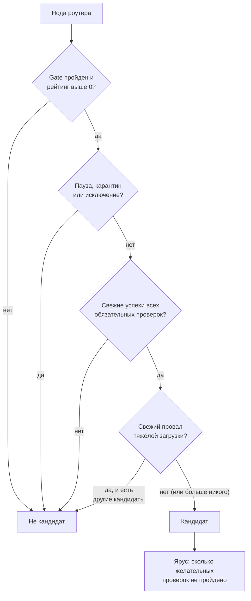
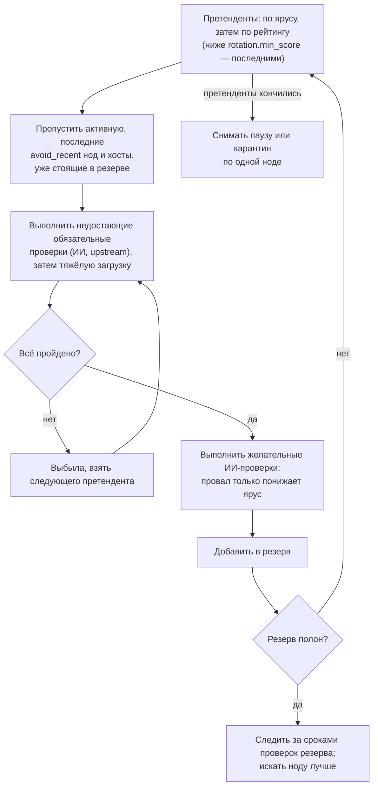
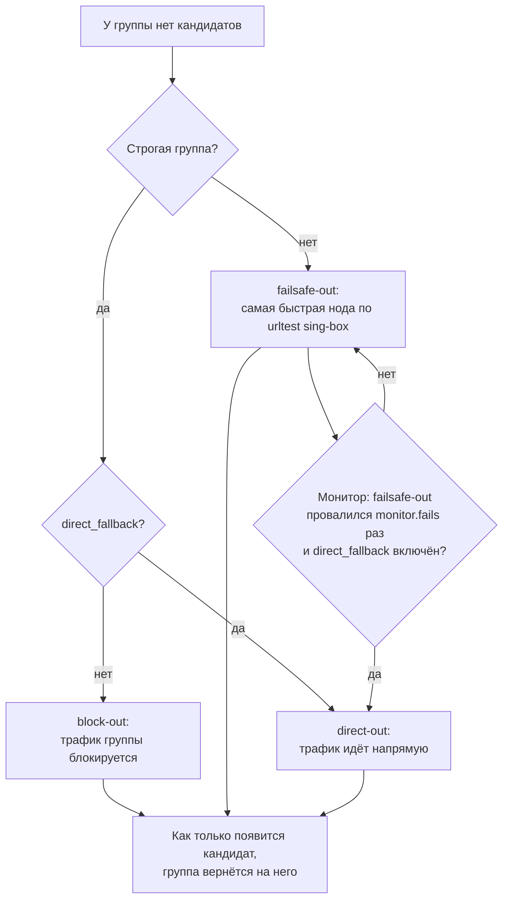

[English](groups.md) | **Русский**

# Группы и кандидаты

Группа — способ сказать nodes-tester, что нужно определённому виду трафика. «Европейские ноды», «выход в США», «ИИ-сервисы из страны,
которую они пускают» — каждое из этого группа со своими проверками. Правила маршрутизации sing-box отправляют трафик в группу, а
тестер держит выбранной в ней лучшую подходящую ноду.

<a id="selector"></a>
## Группа в sing-box

Каждая группа превращается в selector sing-box `{tag}-auto-out`: для группы `eu` это `eu-auto-out`. В selector входят **все** ноды
роутера, запасной выход и, с `direct_fallback`, `direct-out`. Какая нода выбрана, решает тестер через API sing-box. Раз каждая нода
есть в каждой группе, смена выбора не требует новой конфигурации: выбор меняется на лету.

Сборка также создаёт:

- `global-auto-out` — selector групп с отметкой «Входит в global-auto-out» (`in_global`, включено по умолчанию);
- `failsafe-out` — `urltest` sing-box по всем нодам: в нём sing-box сам держит самую быстро отвечающую ноду;
- `nodes-tester` — собственный selector тестера для замеров.

Без раздела `groups` в `config.json` собирается одна группа `all`. В клиентской ветви всегда одна группа `global-auto-out` со всеми
нодами: там выбирает сам клиентский sing-box.

<a id="checks"></a>
## Обязательные и желательные проверки

Для каждой [проверки](checks.ru.md#checks) группа задаёт один из трёх режимов:

| Режим | Действие |
|---|---|
| не учитывать | проверка для группы не важна |
| **обязательна** (`require`) | без свежего успеха проверки нода не может быть кандидатом |
| **желательна** (`prefer`) | нода может быть кандидатом и без неё, но прошедшие идут первыми |

У двух проверок есть условия:

- **Страна выхода** (`country`): `countries` (ISO-коды), `regions` и исключения `exclude_countries`, `exclude_regions`. Например,
  «любая страна, кроме России»: `exclude_countries: ["ru"]`.
- **Тип выходного IP** (`ip_type`): `kinds` — разрешённые типы: `residential` (домашний), `mobile` (мобильный), `hosting`
  (дата-центр), `proxy` (IP, известный как VPN или прокси).

Типичная ИИ-группа требует выход не в России, совпадение страны по базам и все три ИИ-сервиса, а предпочитает домашние или мобильные IP:

```json
{
  "tag": "ai",
  "strict": true,
  "require": { "country": { "exclude_countries": ["ru"] }, "geo_consistent": {},
               "gemini": {}, "openai": {}, "anthropic": {} },
  "prefer": { "ip_type": { "kinds": ["residential", "mobile"] } }
}
```

<a id="candidates"></a>
## Кто кандидат



Провал тяжёлой загрузки исключает ноду, только пока есть другие кандидаты: если провалили все, группа всё равно выбирает среди них, а не
остаётся пустой.

Кандидатов группы видно всегда:

- блок [«Группы»](overview.ru.md#groups) на «Обзоре»: активная нода, число кандидатов и резерв;
- вкладка [«Группы»](node-card.ru.md#groups) карточки ноды: для каждой группы — кандидат ли нода и вердикты каждой проверки с возрастом;
- под каждой группой в редакторе групп на [«Подписках и сборке»](subscriptions.ru.md#groups).

<a id="tiers"></a>
## Порядок кандидатов: ярусы и рейтинг

Кандидаты упорядочены по **ярусу**, внутри яруса — по рейтингу:

1. ярус 0 — все желательные проверки пройдены; ярус 1 — одна не пройдена; и так далее;
2. нода с рейтингом ниже `tier_floor` (75 по умолчанию, `selection.tier_floor` или свой `tier_floor` группы) идёт после всех остальных
   ярусов: слабая нода, прошедшая желательные проверки, не должна обгонять сильные, которые их не прошли;
3. внутри яруса — по рейтингу, сначала выше.

Активная нода всегда берётся из лучшего доступного яруса. Замена по качеству никогда не переводит группу в худший ярус.

<a id="reserve"></a>
## Резерв

Резерв — короткий список кандидатов, проверенных заранее, чтобы активную ноду можно было заменить мгновенно. Его размер —
`selection.reserve` (3) или свой `reserve` группы. Резерв ведёт отдельный фоновый процесс, независимо от обычных замеров:



Подробности работы резерва:

- Свежий результат не повторяется: нода, прошедшая Gemini час назад, заново не проверяется.
- После смены активной ноды (ротация, авария, качество) резерв сразу пополняется.
- Когда истекает проверка участника резерва, она повторяется. Обязательные проверки активной ноды повторяются за 5 минут до истечения;
  провал — замена из резерва.
- Когда резерв полон, после каждого замера тестер ищет ноду лучше худшего участника резерва: лучшего яруса или с рейтингом выше на
  `selection.reserve_margin`. Такая нода проходит те же проверки и занимает место; если не прошла, 15 минут её не пробуют снова.
- В резерве не больше одной ноды на хост и нет нод хоста активной: ноды одного сервера падают вместе.

<a id="lifting"></a>
### Когда претендентов нет

Если претенденты кончились, а резерв не полон, процесс резерва снимает [паузу или карантин](restrictions.ru.md) с нод, ограниченных
дольше всех, по одной, и сразу их проверяет. Не снимаются ноды, которые точно не подойдут (известная неверная страна выхода, свежий
провал обязательной проверки), ноды уже занятых или оштрафованных хостов и ручные исключения. Не больше трёх снятий на группу за круг;
нода, снова провалившая gate, возвращается в карантин и снимается не раньше чем через 6 часов. Если снимать некого, новая попытка —
через 15 минут или когда появятся новые ноды.

<a id="fallback"></a>
## Кандидатов нет: запасные выходы



| Настройки группы | Без кандидатов | Когда использовать |
|---|---|---|
| нестрогая | `failsafe-out` | общий трафик: любая рабочая нода лучше, чем ничего |
| нестрогая + `direct_fallback` | `failsafe-out`, а если не отвечает и он — `direct-out` | трафик, который в аварии может идти напрямую |
| **строгая** | `block-out` | трафик, который никогда не должен уходить через неподходящую ноду (ИИ-сервисы, аккаунты, привязанные к стране) |
| строгая + `direct_fallback` | `direct-out` | трафик, который может идти напрямую, но не через неподходящую ноду |

`block-out` должен быть в `base.json` (`{"type": "block", "tag": "block-out"}`). Переход на запасной выход записывается в
[историю переключений](switches.ru.md) с причиной «Кандидатов нет — запасной выход» и может приходить [уведомлением](settings.ru.md#notifications)
`failsafe`.

<a id="regions"></a>
## Регионы

Регион — именованный список стран для проверки `country` и для `for_region` тестов. Встроенные регионы:

| Регион | Страны |
|---|---|
| `eu` | европейские страны |
| `us` | `us` |
| `ru` | `ru` |
| `other` | все страны не из `eu`, `us` и `ru` |

Встроенный регион можно переопределить, а свои регионы добавляются в блоке «Регионы» редактора групп или в разделе `regions`:
`{"asia": ["jp", "sg", "kr"]}`.

<a id="order"></a>
## Порядок групп

Порядок групп в редакторе — их порядок в конфигурации sing-box и в `global-auto-out`. На выбор ноды группой он не влияет.

<a id="see-also"></a>
## См. также

- [Переключения](switching.ru.md): когда и как меняется активная нода.
- [Раздел `groups`](../CONFIG.ru.md#groups) справочника.
