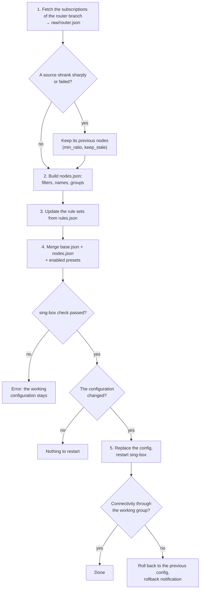

**English** | [Русский](pipeline.ru.md)

# Pipeline

The pipeline turns subscriptions into a working sing-box configuration. This page starts it by hand, shows its live log and the
history of runs, and sets the daily schedule. It needs the administrator token and the embedded admin panel.

<a id="router"></a>
## The router run



- With a **check** (dry run) the pipeline downloads the sources and writes the intermediate files, builds the candidate and runs
  `sing-box check`, but does not update the rules, does not replace the configuration and does not restart sing-box.
- While the router configuration is applied, the tester pauses checks and switching, and keeps the pause for another 120 seconds
  after the pipeline ends: measurements during a restart would be wrong.
- sing-box 1.10 and newer rereads changed rule sets without a restart.
- If you work through the same router, a sing-box restart briefly interrupts the admin panel and SSH.
- While sing-box is stopped from the [Overview](overview.md#singbox), the pipeline does not apply a configuration.

How the configuration is merged from the base and presets: [config assembly](../CONFIG_ASSEMBLY.md).

<a id="clients"></a>
## The clients run

The client run fetches no subscriptions: it builds `whnodes.json` from `nodes.json` and the nodes that passed the checks of the
[client groups](subscriptions.md#client-groups) on the router, and for every enabled [client](subscriptions.md#clients) merges it
with the client base `singbox/clients/base_<name>.json` and the enabled client presets (or takes the ready file
`singbox/clients/publish/<name>.json`). Each config passes `sing-box check` before it is published to `/etc/sing-box-clients/`
and `by-token/<token>.json`; a client whose config fails stays on the previous one. The links of deleted and disabled clients and
of old tokens stop working. A client group without nodes, or tester data older than 30 minutes, stops the run, and all clients keep
their configs. The client run does not touch the router sing-box. The web server that gives the files to the clients is configured
separately ([example](../../scripts/router/README.md#clients)).

<a id="run"></a>
## Running by hand

Each branch has a block with the time of the next scheduled run and two buttons:

- **Check (dry run)** — everything except applying; read the log before applying;
- **Apply** — the full run; asks for confirmation.

Only one pipeline runs at a time, including runs from the terminal and by schedule. The line under the blocks says what is running
now. The same on the router:

```sh
nodes-tester pipeline router --dry-run
nodes-tester pipeline router
nodes-tester pipeline clients --dry-run
nodes-tester pipeline clients
```

<a id="log"></a>
## Log

The log of the selected run, updated live. A new run opens automatically; “To the current run” returns to it after you opened an
old one. The log shows each fetched subscription and the number of its nodes, the filters, the result of `sing-box check`, the
restart and the connectivity check.

<a id="history"></a>
## History

The last 20 runs: start, mode, check or apply, who started it, status, and a button to open the log.

| Mode | What it is |
|---|---|
| router | the full router run |
| clients | the full client run |
| subscription fetch | the separate poll of router subscriptions (`pipeline.fetch.every`): only raw nodes and the subscription state, sing-box is not touched |
| base and rules | applying the base and presets from the [“Rules”](rules.md) page, without fetching subscriptions |
| client rules | building client configs from the “Rules” page, without fetching subscriptions |

| Started | Meaning |
|---|---|
| scheduled | by the daily schedule |
| manually | a button in the admin panel |
| rebuild on degradation | by the tester itself ([why](switching.md#rebuild)) |

| Status | Meaning |
|---|---|
| running | the run is in progress |
| succeeded (`ok`) | finished without errors |
| error | finished with an error; the reason is at the end of the log |
| busy | another run was in progress (exit code 75); nothing was done |
| timeout | the run took longer than `pipeline.timeout` (30 min) and was stopped |
| interrupted | the process ended without a confirmed exit code (for example, the tester restarted) |

Logs are kept in `<data_dir>/pipeline/runs/`, the history in `<data_dir>/pipeline.db`.

<a id="schedule"></a>
## Daily schedule

For each branch: a switch and the times of day `HH:MM` by the router clock, comma-separated, without repeats. For a run every three
hours: `00:00, 03:00, 06:00, 09:00, 12:00, 15:00, 18:00, 21:00`. “Run timeout” limits one run in seconds.

- The schedule takes effect right after saving.
- A run missed while the tester was restarting is done once after the start.
- A scheduled build that comes during a subscription poll waits for it to finish.
- These are the same fields as `pipeline.router.at` / `pipeline.clients.at` on [“Subscriptions and build”](subscriptions.md#schedule-filters).

If the pipeline is also started by cron (`nodes-tester pipeline` in `/etc/crontabs/root`), remove that line after enabling the
schedule here; otherwise one of two coinciding runs gets the “busy” status.
