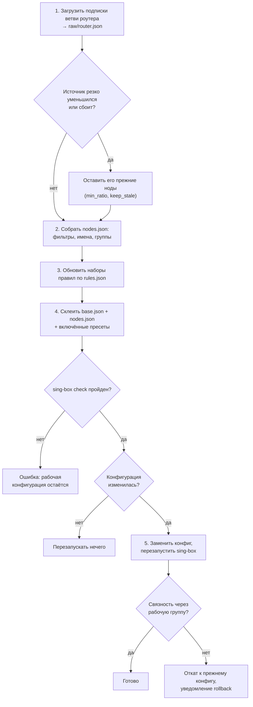

[English](pipeline.md) | **Русский**

# Конвейер

Конвейер превращает подписки в рабочую конфигурацию sing-box. Эта страница запускает его вручную, показывает живой журнал и историю
прогонов и задаёт ежедневное расписание. Нужны токен администратора и встроенная админка.

<a id="router"></a>
## Прогон роутера



- При **проверке** (dry-run) конвейер скачивает источники и пишет промежуточные файлы, собирает кандидата и выполняет `sing-box check`,
  но не обновляет правила, не заменяет конфигурацию и не перезапускает sing-box.
- Пока применяется конфигурация роутера, тестер приостанавливает проверки и переключения и держит паузу ещё 120 секунд после конца
  конвейера: замеры во время перезапуска были бы неверными.
- sing-box 1.10 и новее перечитывает изменённые наборы правил без перезапуска.
- Если вы работаете через этот же роутер, перезапуск sing-box ненадолго прервёт админку и SSH.
- Пока sing-box остановлен с [Обзора](overview.ru.md#singbox), конвейер конфигурацию не применяет.

Как конфигурация склеивается из базы и пресетов — [сборка конфига](../CONFIG_ASSEMBLY.ru.md).

<a id="clients"></a>
## Прогон клиентов

Прогон клиентов подписки не загружает: он собирает `whnodes.json` из `nodes.json` и нод, прошедших на роутере проверки
[клиентских групп](subscriptions.ru.md#client-groups), и для каждого включённого [клиента](subscriptions.ru.md#clients) склеивает его
с клиентской базой `singbox/clients/base_<имя>.json` и включёнными клиентскими пресетами (или берёт готовый файл
`singbox/clients/publish/<имя>.json`). Каждый конфиг проходит `sing-box check` до публикации в `/etc/sing-box-clients/` и
`by-token/<токен>.json`; клиент, чей конфиг не прошёл, остаётся на прежнем. Ссылки удалённых и выключенных клиентов и старых токенов
перестают работать. Клиентская группа без нод или данные тестера старше 30 минут останавливают прогон, и все клиенты остаются на
прежних конфигах. Прогон клиентов не трогает sing-box роутера. Веб-сервер, который отдаёт файлы клиентам, настраивается отдельно
([пример](../../scripts/router/README.ru.md#clients)).

<a id="run"></a>
## Ручной запуск

У каждой ветви — блок со временем следующего запуска по расписанию и две кнопки:

- **Проверить (dry-run)** — всё, кроме применения; прочитайте журнал перед применением;
- **Применить** — полный прогон; спрашивает подтверждение.

Одновременно идёт только один конвейер, включая запуски из терминала и по расписанию. Строка под блоками говорит, что выполняется
сейчас. То же на роутере:

```sh
nodes-tester pipeline router --dry-run
nodes-tester pipeline router
nodes-tester pipeline clients --dry-run
nodes-tester pipeline clients
```

<a id="log"></a>
## Журнал

Журнал выбранного прогона, обновляется вживую. Новый прогон открывается сам; «К текущему прогону» возвращает к нему, если вы открыли
старый. В журнале видны каждая загруженная подписка и число её нод, фильтры, итог `sing-box check`, перезапуск и проверка связности.

<a id="history"></a>
## История

Последние 20 прогонов: начало, режим, проверка или применение, кто запустил, статус и кнопка открытия журнала.

| Режим | Что это |
|---|---|
| роутер | полный прогон роутера |
| клиенты | полный прогон клиентов |
| опрос подписок | отдельный опрос подписок роутера (`pipeline.fetch.every`): только сырые ноды и состояние подписок, sing-box не трогается |
| база и правила | применение базы и пресетов со страницы [«Правила»](rules.ru.md), без загрузки подписок |
| клиентские правила | сборка клиентских конфигов со страницы «Правила», без загрузки подписок |

| Запуск | Что значит |
|---|---|
| по расписанию | по ежедневному расписанию |
| вручную | кнопкой в админке |
| пересборка по деградации | самим тестером ([зачем](switching.ru.md#rebuild)) |

| Статус | Что значит |
|---|---|
| выполняется | прогон идёт |
| успешно (`ok`) | закончился без ошибок |
| ошибка | закончился с ошибкой; причина — в конце журнала |
| занято | шёл другой прогон (код выхода 75); ничего не сделано |
| тайм-аут | прогон шёл дольше `pipeline.timeout` (30 мин) и был остановлен |
| прервано | процесс завершился без подтверждённого кода выхода (например, перезапустился тестер) |

Журналы хранятся в `<data_dir>/pipeline/runs/`, история — в `<data_dir>/pipeline.db`.

<a id="schedule"></a>
## Ежедневное расписание

Для каждой ветви: переключатель и время суток `HH:MM` по часам роутера, через запятую, без повторов. Для запуска каждые три часа:
`00:00, 03:00, 06:00, 09:00, 12:00, 15:00, 18:00, 21:00`. «Тайм-аут прогона» ограничивает один прогон в секундах.

- Расписание действует сразу после сохранения.
- Прогон, пропущенный во время перезапуска тестера, выполняется один раз после старта.
- Сборка по расписанию, пришедшая во время опроса подписок, ждёт его окончания.
- Это те же поля, что `pipeline.router.at` / `pipeline.clients.at` на [«Подписках и сборке»](subscriptions.ru.md#schedule-filters).

Если конвейер запускается ещё и из cron (`nodes-tester pipeline` в `/etc/crontabs/root`), уберите эту строку после включения расписания
здесь; иначе один из двух совпавших прогонов получит статус «занято».
