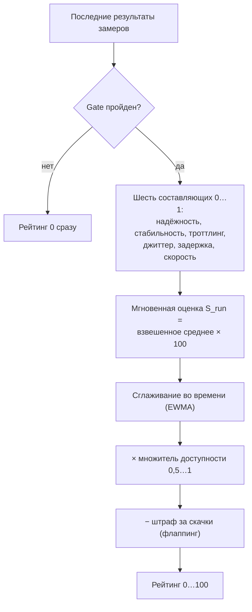

[English](rating.md) | **Русский**

# Рейтинг

Рейтинг — одно число от 0 до 100: насколько нода хороша сейчас и насколько стабильна была. Группы выбирают среди кандидатов по
рейтингу, ротация предпочитает ноды с рейтингом выше, а рейтинг 0 значит, что нода не используется вовсе.

Рейтинг обновляется после каждого визита ноды. Он строится из последнего результата каждого замера, даже если замеры сделаны в разное
время (у них свои [сроки жизни](checks.ru.md#lifetimes)).

<a id="formula"></a>
## Как считается рейтинг



<a id="gate"></a>
## Gate

Gate — базовое условие «нода жива». Он провален, если выполнено хотя бы одно:

- `connectivity` не прошёл: соединения через ноду нет;
- потери в `jitter` выше `rating.thresholds.loss_gate_percent` (50 % по умолчанию);
- `reachability` проверил сайты, но не достучался ни до одного;
- провалились все тесты, у которых есть признак успеха.

При провале gate рейтинг сразу становится 0, без сглаживания: история не прячет ноду, которая мертва сейчас. Провал gate также
запускает [паузу](restrictions.ru.md#pause).

<a id="components"></a>
## Составляющие

Каждая составляющая приводится к диапазону от 0 (плохо) до 1 (хорошо) между двумя порогами `rating.thresholds`:

| Составляющая | Источник | Пороги (плохо → хорошо) | Вес |
|---|---|---|---:|
| надёжность | успешные запросы, удержание закачки, доступные сайты | — | 0,35 |
| стабильность | джиттер, делённый на среднюю задержку | `variation` 0,8 → 0,1 | 0,20 |
| троттлинг | скорость последнего окна закачки к первому | `throttle` 0,3 → 0,9 | 0,15 |
| джиттер | разброс задержки | `jitter` 250 мс → 15 мс | 0,10 |
| задержка | время до первого байта | `latency` 1,5 с → 150 мс | 0,10 |
| скорость | скорость закачки | `download_mbps` 2 → 25 Мбит/с | 0,10 |

Между порогами значение меняется линейно, за ними остаётся 0 или 1. Надёжность сама составная: успешные запросы (`1 − потери`) с весом
0,5, удержание закачки (доля полученного файла) 0,3 и доля доступных сайтов 0,2.

Отсутствующий замер не даёт нуля: его составляющая исключается, а оставшиеся веса пересчитываются. Отказ тестового сервера (HTTP 429
или 5xx) нейтрален для скорости: транспорт ответил, сервис — нет.

<a id="instant"></a>
## Мгновенная оценка

```text
S_run = 100 × Σ(вес × составляющая) / Σ(веса доступных составляющих)
```

`connectivity` сам по себе подтверждает доступ, но не даёт качества: у ноды, у которой есть только результат соединения, `S_run` 0.

<a id="smoothing"></a>
## Сглаживание во времени

После каждого замера обновляются три величины с коэффициентом `alpha` (`rating.alpha`, 0,3 по умолчанию):

```text
score_ewma = alpha × S_run + (1 − alpha) × прежний score_ewma
flap       = alpha × |S_run − прежний score_ewma| + (1 − alpha) × прежний flap
avail      = alpha × gate + (1 − alpha) × прежний avail        (gate: 1 пройден, 0 провален)
```

Итоговый рейтинг:

```text
рейтинг = clamp(score_ewma × множитель доступности − flap_lambda × flap, 0, 100) × надёжность
```

- **Множитель доступности**: при доступности `availability.floor` (0,7) и ниже он равен 0,5, от `availability.full` (0,9) — 1, между
  ними — линейно. Нода, которая часто проваливает gate, теряет до половины рейтинга.
- **Надёжность**: аварии ноды на час работы активной за 7 дней, сглаженные к частоте её поставщика, дают
  `1 / (1 + частота)` (не ниже 0,3; `selection.stability`). У ноды без истории — частота поставщика.
- **Штраф за флаппинг**: `flap_lambda` (0,5) × средний скачок оценки. Нода, отличная в один час и плохая в другой, стоит ниже ровно
  хорошей.

Так один хороший замер не перекрывает нестабильную историю, а один плохой (кроме провала gate) не губит хорошую ноду.

<a id="reading"></a>
## Как читать рейтинг

| Что видно | Что значит |
|---|---|
| 70 и выше (зелёный) | хорошая, стабильная нода |
| 20 и ниже (красный) | слабая или нестабильная; группы берут её последней |
| 0 | gate провален сейчас или ещё нет оценочных замеров |
| «Нет замеров» | нода ещё не измерена; это не провал |

Цвета — лишь ориентир; у правил переключения свои пороги:

- `selection.rotation.min_score` (55): ротация не выбирает ноды с рейтингом ниже;
- `selection.tier_floor` (75): ниже нода уходит в более низкий [ярус](groups.ru.md#tiers), даже если прошла желательные проверки;
- `selection.comfort_floor` (50): выше него активная нода не меняется по качеству без запаса;
- `selection.quarantine.low_score` (0, выключено): живая, но слабая нода ниже порога уходит в [карантин](restrictions.ru.md#low-score).

Физические величины — мс, Мбит/с, потери — на странице [«Результаты»](nodes.ru.md#results); нормированные составляющие — на странице
[«Рейтинг»](nodes.ru.md#rating); история одной ноды — в её [карточке](node-card.ru.md#state).

<a id="tuning"></a>
## Настройка

Пороги и веса — в разделе `rating` ([справочник](../CONFIG.ru.md#rating)). Меняйте один класс параметров за раз и судите по
нескольким замерам:

1. пороги определяют, как физическая величина превращается в составляющую;
2. веса определяют, какие составляющие важнее;
3. `alpha` задаёт, как быстро реагирует рейтинг (больше — быстрее, но дёрганее);
4. `flap_lambda` усиливает или ослабляет штраф за нестабильность;
5. `availability.floor` и `availability.full` задают цену частых провалов.

Старая история не пересчитывается: новые значения влияют на следующие обновления.
