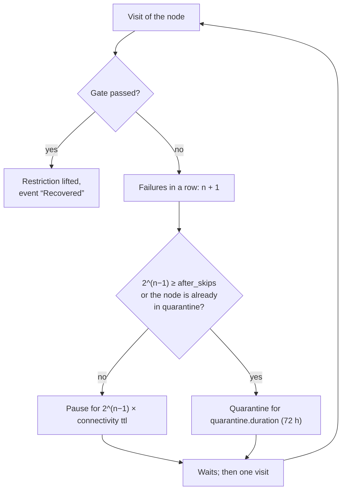

**English** | [Русский](restrictions.ru.md)

# Pause, quarantine and exclusion

A dead node costs time and traffic on every check, and checking it again and again from the same address attracts the
attention of DPI. So the tester checks failing nodes less and less often, and finally sets them aside. An administrator
can also exclude a node by hand. None of this removes the node from the subscription or erases its history.

## Pause after gate failures

Every failure of the [gate](rating.md#gate) in a row makes the next check wait longer. After the n-th failure in a row
the node is not checked for 2^(n−1) periods of the `connectivity` measurement (3 h by default):

| Failure in a row | Pause |
|---:|---|
| 1 | 3 h |
| 2 | 6 h |
| 3 | 12 h |
| 4 | 24 h |
| 5 | 48 h |
| 6 | quarantine |

When the pause would reach `selection.quarantine.after_skips` periods (32 by default), the node goes to quarantine
instead.

A paused or quarantined node is not a [candidate](groups.md#candidates). If it is active in a group, the group switches to
another node right away (an emergency replacement).

## Quarantine

Quarantine is a long rest: `selection.quarantine.duration` (72 h). After it the node gets one check. A passed gate lifts the
quarantine; a failure sends the node back for another full period.

An administrator can quarantine a node by hand (“Quarantine” in the [node card](node-card.md#actions)) for the same
duration.

### Quarantine for weak nodes

`selection.quarantine.low_score` (0 — off) also quarantines nodes that are alive but weak: a rating below the threshold
after at least 3 measurements. Active nodes are not touched. After the quarantine the node comes back if its rating by
the probe reaches the threshold.

## Lifting a restriction

- **Automatically**: a passed gate at the next visit lifts a pause or quarantine at once.
- **By the reserve**: when a group runs out of contenders, the reserve process lifts restrictions one node at a time,
  starting from the nodes restricted the longest, and checks them right away. See
  [When there are no contenders](groups.md#lifting).
- **By hand**: “Lift restriction” in the node card puts the node back into the check queue. It does not confirm that the
  node works: the next check decides.

## Exclusion (ban)

“Exclude” in the node card removes the node from all checks indefinitely, until “Remove exclusion”. Use it for nodes you do
not want to be used at all: a test server of the provider, a node with a known problem the checks do not catch.

- If the node is active, its groups switch to another node or the fallback outbound right away.
- The exclusion is not lifted by the reserve and does not expire.
- It does not remove the node from the subscription and does not erase its history.

To exclude nodes by name for good, use “Exclude nodes by a name substring” of the subscription
([Subscriptions and build](subscriptions.md#sources)): such nodes do not even get into the configuration.

## Node statuses

A node can have several flags at once; the node list and the card show all of them.

| Status | Meaning | Set by |
|---|---|---|
| missing | not in the current tester list; the history is kept for `storage.retention` after the last presence | sing-box list |
| excluded manually | indefinite exclusion from checks; does not remove the node from the subscription | administrator |
| quarantine | a long restriction for `selection.quarantine.duration`; a new check afterwards | tester or administrator |
| checks paused | after gate failures the node is not checked for 2^(n−1) `connectivity` periods | tester |
| selected by the switcher | the last choice of the switcher in a group; it is not a check of the actual selector or of the connection | switcher |
| positive rating | the node has a rating above zero | tester |
| rating 0 | the gate failed or there are no scoring measurements; see the results and events | tester |
| no measurements | there is no saved rating; this is not a failure | — |

## Events

Restrictions are recorded as node events: “Pause”, “Quarantined”, “Recovered”, “Excluded”, “Exclusion removed”,
“Restriction lifted”, “Disappeared from the list”. They are shown on the “Events” tab of the
[node card](node-card.md#events); a pause is recorded once when it starts, not on every failure.

## See also

- [“Restrictions and quality” page](nodes.md#restrictions): the list of paused and quarantined nodes.
- [`selection.quarantine`](../CONFIG.md#selection) in the reference.
