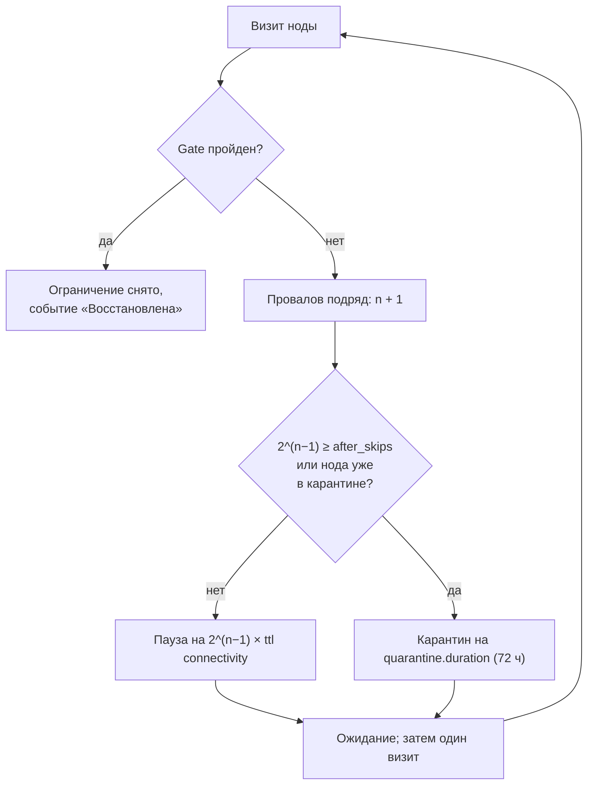

[English](restrictions.md) | **Русский**

# Пауза, карантин и исключение

Мёртвая нода отнимает время и трафик на каждой проверке, а повторные обращения к ней с одного адреса привлекают внимание DPI. Поэтому
тестер проверяет сбойные ноды всё реже, а в конце откладывает их. Администратор может и вручную исключить ноду. Ничто из этого не
удаляет ноду из подписки и не стирает её историю.

## Пауза после провалов gate

Каждый провал [gate](rating.ru.md#gate) подряд удлиняет ожидание следующей проверки. После n-го провала подряд нода не проверяется
2^(n−1) сроков замера `connectivity` (3 ч по умолчанию):

| Провал подряд | Пауза |
|---:|---|
| 1 | 3 ч |
| 2 | 6 ч |
| 3 | 12 ч |
| 4 | 24 ч |
| 5 | 48 ч |
| 6 | карантин |

Когда пауза дошла бы до `selection.quarantine.after_skips` сроков (32 по умолчанию), нода вместо этого уходит в карантин.

Нода на паузе или в карантине — не [кандидат](groups.ru.md#candidates). Если она активна в группе, группа сразу переходит на другую
ноду (аварийная замена).

## Карантин

Карантин — долгий отдых: `selection.quarantine.duration` (72 ч). После него нода получает одну проверку. Пройденный gate снимает
карантин; провал возвращает ноду ещё на полный срок.

Администратор может отправить ноду в карантин вручную («В карантин» в [карточке ноды](node-card.ru.md#actions)) на тот же срок.

### Карантин для слабых нод

`selection.quarantine.low_score` (0 — выключено) отправляет в карантин и живые, но слабые ноды: рейтинг ниже порога после не меньше чем
3 замеров. Активные ноды не трогаются. После карантина нода возвращается, если её рейтинг по пробе дорос до порога.

## Снятие ограничения

- **Автоматически**: пройденный gate на следующем визите сразу снимает паузу или карантин.
- **Резервом**: когда у группы кончаются претенденты, процесс резерва снимает ограничения по одной ноде, начиная с ограниченных дольше
  всех, и сразу их проверяет. См. [Когда претендентов нет](groups.ru.md#lifting).
- **Вручную**: «Снять ограничение» в карточке ноды возвращает её в очередь проверки. Это не подтверждает, что нода работает: решит
  следующая проверка.

## Исключение (бан)

«Исключить» в карточке ноды убирает ноду из всех проверок бессрочно, до «Снять исключение». Пригодится для нод, которые вообще не
должны использоваться: тестовый сервер провайдера, нода с известной проблемой, которую проверки не ловят.

- Если нода активна, её группы сразу переходят на другую ноду или запасной выход.
- Исключение не снимается резервом и не истекает.
- Оно не удаляет ноду из подписки и не стирает её историю.

Чтобы исключить ноды по имени насовсем, используйте «Исключать ноды по подстроке имени» у подписки
([Подписки и сборка](subscriptions.ru.md#sources)): такие ноды даже не попадают в конфигурацию.

## Статусы нод

У ноды может быть несколько признаков одновременно; список нод и карточка показывают все.

| Статус | Что значит | Кто ставит |
|---|---|---|
| отсутствует | нет в текущем списке тестера; история хранится `storage.retention` после последнего присутствия | список sing-box |
| исключена вручную | бессрочное исключение из проверок; не удаляет ноду из подписки | администратор |
| карантин | долгое ограничение на `selection.quarantine.duration`; затем новая проверка | тестер или администратор |
| пауза проверок | после провалов gate нода не проверяется 2^(n−1) сроков `connectivity` | тестер |
| выбрана переключателем | последний выбор переключателя в группе; это не проверка реального селектора и не соединения | переключатель |
| рейтинг положительный | у ноды рейтинг выше нуля | тестер |
| рейтинг 0 | провален gate или нет оценочных замеров; смотрите результаты и события | тестер |
| нет замеров | сохранённого рейтинга нет; это не провал | — |

## События

Ограничения записываются как события ноды: «Пауза», «Карантин», «Восстановлена», «Исключена», «Исключение снято», «Ограничение
снято», «Исчезла из списка». Они видны на вкладке «События» [карточки ноды](node-card.ru.md#events); пауза записывается один раз при
начале, а не на каждый провал.

## См. также

- [Страница «Ограничения и качество»](nodes.ru.md#restrictions): список нод на паузе и в карантине.
- [`selection.quarantine`](../CONFIG.ru.md#selection) в справочнике.
