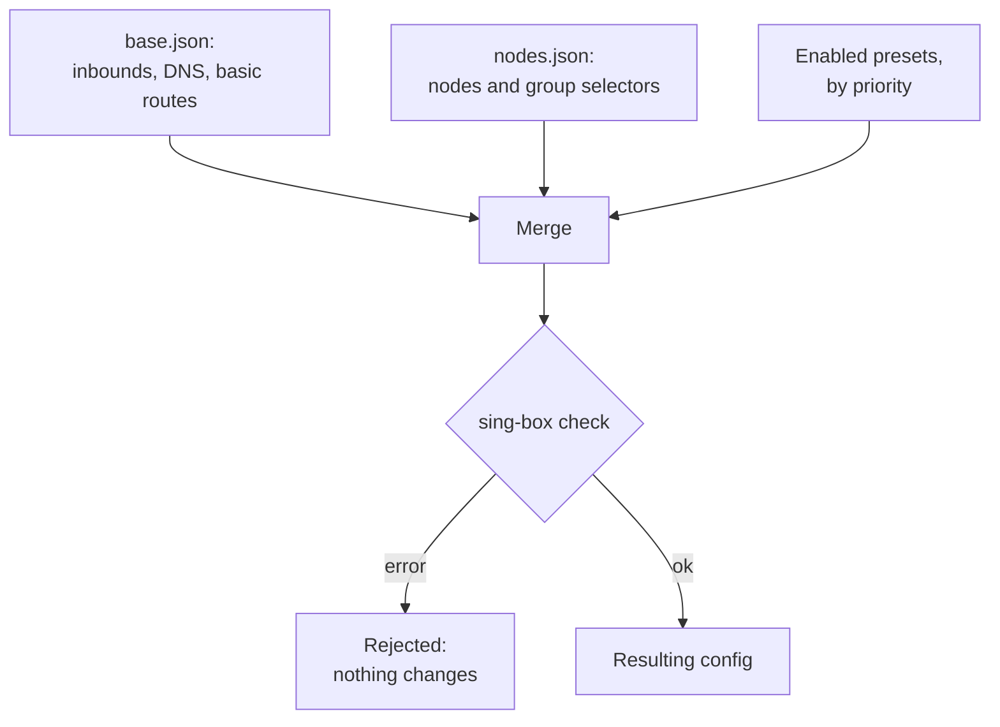

**English** | [Русский](rules.ru.md)

# Rules

Routing and DNS rules of sing-box are built from **presets**: separate JSON files, each with one piece of logic — “AI services
through the `ai` group”, “Russian sites directly”, “ads blocked”. This page turns presets on and off and applies the base with the
enabled presets to sing-box without fetching subscriptions. It needs the administrator token and the embedded admin panel.

## How the configuration is assembled

- A preset holds everything the base lacks: its own route and DNS rules, DNS servers, rule sets, outbounds.
- Rules go in the order of `priority` of the presets (lower first); `priorities` overrides it for one path, for example
  `{"dns.rules": 150}` puts the DNS rules of the preset elsewhere.
- Identical objects from different presets merge into one; the same tag with different content is an error.
- The preset metadata (title, description, priority, required groups, the switch) is in its `_preset` key and does not get into
  the configuration.

The full description of merging and the catalogue of ready presets: [config assembly](../CONFIG_ASSEMBLY.md).

## Router and Clients tabs

| Tab | Presets | Merged with |
|---|---|---|
| Router | `singbox/presets/` | `base.json` and `nodes.json` → the router sing-box |
| Clients | `singbox/clients/presets/`, shared by all clients | each client base `clients/base_<name>.json` and `whnodes.json` → the configs of the [clients](subscriptions.md#clients) |

## Presets

The table lists the presets of the tab by priority:

| Column | Meaning |
|---|---|
| On | the switch |
| Preset | the title and description from `_preset` |
| Priority | the order of its rules; paths with their own priority are listed below |
| Required groups | groups the preset refers to (for example `ai` for `ai-auto-out`); groups missing in the current `nodes.json` are highlighted |
| File | opens the preset in [“sing-box files”](singbox-files.md) |

**The switch changes the preset file only.** Before saving it, the server builds the resulting configuration (for the clients — the
config of each client) and runs `sing-box check`; if the check fails, the file does not change and the page shows the reason. The
running sing-box changes only with “Apply”.

A preset that needs a group that is not in `nodes.json` will not pass the check: add the group on
[“Subscriptions and build”](subscriptions.md#groups) and run the router pipeline first. Below the table: the groups of the current
`nodes.json` and, on the Clients tab, the enabled clients (the list is on [“Subscriptions and build”](subscriptions.md#clients)).

New presets are created in “sing-box files” as `presets/<name>.json` (or `clients/presets/<name>.json`); ready ones are in
`/usr/share/nodes-tester/examples/singbox/presets/`.

## Applying

- **Check the build** — builds the configuration from the editable base and the enabled presets with the current `nodes.json` and
  runs `sing-box check`, changing nothing.
- **Apply** — copies the base, builds the configuration, restarts sing-box only if it changed and checks connectivity; without
  connectivity the previous configuration comes back. Subscriptions are not fetched.

The log of the run is shown on the page; coming back to the page shows the status and log of the last run of the tab. The full
history is on the [“Pipeline”](pipeline.md#history) page (modes “base and rules” and “client rules”).

## Client build

On the Clients tab “Build clients” builds and publishes the configs of all clients from the current `whnodes.json`
(`nodes-tester pipeline apply-clients`); “Check the build” builds them into a separate directory without publishing. A client
whose config fails `sing-box check` is not published and keeps the previous config.

A client gets the local rule sets of the router presets over the network from the distribution address. Set it in
`clients/settings.json`: `{"rules_url": "https://…/"}`. Without it, a client preset with local rule sets cannot be built, and the
page warns about it. Details: [client presets](../CONFIG_ASSEMBLY.md#client-presets).
