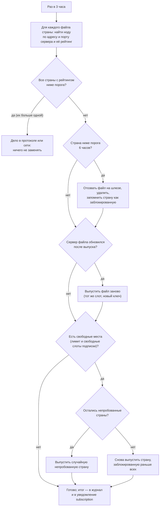

[English](subscriptions.md) | **Русский**

# Подписки и сборка

Эта страница правит часть `config.json`, которая решает, **какие ноды попадут в sing-box и как они сгруппированы**: подписки,
параметры сборки, группы и их проверки, клиентов и их ссылки. У неё три вкладки — «Источники подписок», «Сборка и группы» и
«Клиенты»; у сборки две ветви — «Роутер» и «Клиенты» (чипы под вкладками).

Сохранение файла **не** загружает подписки и не меняет работающий sing-box. Новые подписки, фильтры и группы попадают в sing-box со
следующим запуском [конвейера](pipeline.ru.md); см. [Как изменения попадают в sing-box](#apply).

<a id="branches"></a>
## Ветви «Роутер» и «Клиенты»

| Ветвь | Результат | Кто использует |
|---|---|---|
| Роутер | `nodes.json` | sing-box роутера и тестер |
| Клиенты | `whnodes.json` | клиентские конфиги из нод, которые проверил тестер роутера ([«Правила»](rules.ru.md#clients)) |

Все подписки загружаются вместе, и тестер роутера проверяет все их ноды. Поле «Ветвь» подписки говорит, где её ноды могут нести
трафик:

- **Роутер** — группы роутера;
- **Клиенты** — только группы клиентов. В sing-box роутера такие ноды есть только в селекторе тестера `nodes-tester`: тестер их
  измеряет, трафик роутера через них не идёт;
- **Обе ветви** — и там, и там.

Чипы ветвей — на вкладке «Сборка и группы» и только переключают форму: документ один, и несохранённые правки в другой ветви
сохраняются. Подробнее о ветвях — в [понятиях](concepts.ru.md#branches).

<a id="sources"></a>
## Источники подписок

Каждая подписка — блок с полями:

| Поле | Что значит |
|---|---|
| Название провайдера (уникальный tag) | первая часть тегов её нод; лучше латиница без пробелов |
| Использовать подписку | выключено — подписка остаётся в файле, но не загружается |
| Ветвь | где ноды несут трафик: Роутер, Клиенты или Обе ветви ([выше](#branches)) |
| Источник | вид источника, см. ниже |
| Исключать ноды по подстроке имени | ноды, в имени которых у провайдера есть одна из подстрок, пропускаются (например, `promo, test`) |

URL и секреты скрыты; «Показать секреты и URL подписок» над формой их показывает. Не отправляйте скриншоты с ними.

<a id="kinds"></a>
### Виды источников

| Вид | Что вводить |
|---|---|
| URL / ссылка | URL подписки (`https://…`) или одна ссылка (`vless://`, `vmess://`, `trojan://`, `ss://`, `hy2://`, `sub://` …). Распознаются списки base64, YAML Clash/Mihomo, JSON sing-box и JSON Xray |
| Happ · зашифрованная ссылка | ссылка `happ://crypt…` (crypt–crypt5) приложения Happ; см. [Ключи Happ](#happ-keys) |
| Файл | путь к файлу подписки на роутере, относительно `config.json` |
| Папка AWG | папка с `.conf`-файлами WireGuard/AmneziaWG: формат `awg` и расширение `.conf` |
| Amnezia Premium · ссылка vpn:// | ссылка `vpn://` подписки Amnezia Premium; файлы стран тестер выпускает сам, см. [Amnezia Premium](#amnezia) |
| Свои ноды (outbound-ы sing-box) | JSON-массив своих outbound-ов sing-box; их теги задаёт сборка, провайдер — тег подписки |

Ноды XHTTP и AWG требуют ядро `sing-box-lx`; для обычного sing-box исключите протоколы `xhttp` и `wg` в
[фильтрах ветви](#build). Подробнее — [совместимость с sing-box](../SING_BOX_COMPATIBILITY.ru.md).

<a id="user-agent"></a>
### User-Agent

Для URL-подписок можно выбрать User-Agent загрузки: стандартный браузерный (Safari, по умолчанию), `curl`, `clashmeta` или свой.
Провайдеры часто выбирают по нему формат ответа. Он отправляется только при HTTP-загрузке, не для ссылок и файлов. На пустой HTTP-ответ
загрузчик повторяет запрос с `clashmeta`.

<a id="hwid"></a>
### Идентификатор устройства (HWID)

Некоторые панели подписок ограничивают число устройств и требуют идентификатор устройства. «Отправлять HWID и описание устройства»
включает его для URL-подписки; happ-подписки отправляют его всегда. HWID роутера показан под списком подписок; он хранится в
`device.json` рядом с `config.json`. Свой HWID для одной подписки задаётся заголовком `X-Hwid`.

<a id="state"></a>
### Состояние загрузки

После загрузки подписок каждый блок показывает:

- «Загружена» или «Сбой — работают прошлые ноды» / «Сбой — нод нет», число нод и время последней успешной загрузки; при сбое — текст
  ошибки;
- **В действующем конфиге нод … по последнему опросу …** — сколько нод этой подписки в sing-box сейчас и сколько даст следующая сборка;
  «новые» и «ушедшие» попадут в sing-box со следующей сборкой;
- если панель отдаёт метаданные: название подписки, израсходованный и общий трафик, дату окончания с остатком дней (3 дня и меньше
  выделяются) и сообщение провайдера.

Окончание подписки и расход 90 % трафика могут приходить [уведомлением](settings.ru.md#notifications) `expiry`.

<a id="happ-keys"></a>
### Ключи Happ

Ссылки `happ://crypt…` зашифрованы ключами приложения Happ. Ключи не входят в nodes-tester: они скачиваются из источника в блоке «Ключи
Happ» (по умолчанию `src/keys.rs` проекта hpwnr на GitHub), хранятся в `happ-keys.json` рядом с `config.json` и обновляются, когда к
ссылке не подходит ни один ключ. Источником может быть свой URL или путь к файлу `keys.rs` либо JSON на роутере. «HTTP-заголовки Happ»
подписки правят заголовки загрузки, включая свой User-Agent; отдельный `user_agent` для этого вида игнорируется.

<a id="amnezia"></a>
### Amnezia Premium

Для подписки Amnezia Premium тестер сам выпускает и заменяет файлы стран AmneziaWG через шлюз Amnezia, ориентируясь на рейтинг их нод.

| Поле | Что значит |
|---|---|
| Ссылка vpn:// | ссылка подписки из приложения Amnezia; в ней ключ аккаунта, держите её в секрете |
| Каталог файлов стран | где хранятся файлы `<код страны>.conf` |
| Файл ключа шлюза (PEM) | публичный ключ шлюза Amnezia (в проект не входит: его берут из официального приложения AmneziaVPN, см. [справочник](../CONFIG.ru.md#amnezia-premium)) |
| Адреса шлюза | адреса шлюза, следующий — при сетевом сбое; пусто — `http://gw.amnezia.org/` |
| Только конфиги через relay | конфиг, выданный без relay Amnezia, сразу отзывается: relay шлюз выдаёт только запросам из России, см. [справочник](../CONFIG.ru.md#amnezia-premium) |
| Прокси шлюза | прокси запросов к шлюзу; пусто — прокси загрузки. Через зарубежный выход шлюз выдаёт конфиги без relay |
| Сколько файлов стран держать | сколько стран держать; пусто — все слоты подписки. Слоты сверх лимита остаются свободными для приложения |
| Менять страну с рейтингом ниже | порог рейтинга, 40 по умолчанию |
| Не выпускать страны | коды стран, которые никогда не выпускаются, по умолчанию `ru` |

Раз в 3 часа (через 10 минут после старта тестера) тестер сверяет файлы с рейтингом:



- Страна, заблокированная в эту же проверку, сразу снова не выпускается.
- Страны, выпущенные в другом месте (в приложении; файла в папке нет), не трогаются никогда: новый выпуск сломал бы тот файл.
- Память о пробованных и заблокированных странах — `state.json` в папке; удалите страну из `blocked`, чтобы снова её разрешить.
- Новые файлы попадают в sing-box со следующим опросом подписок и сборкой роутера.

<a id="fetch"></a>
### Защита загрузки

Поля `pipeline.fetch`, которые защищают роутер от плохой или пропавшей подписки:

| Поле | Что значит |
|---|---|
| Тайм-аут загрузки | ограничение времени одной загрузки (`2m`) |
| Минимальная доля оставшихся нод | если подписка вдруг дала меньше этой доли от прежнего числа нод (0,5), прежние ноды сохраняются: сломанный ответ не стирает конфигурацию |
| Повторов HTTP | повторы неудачной загрузки (3) |
| Хранить прошлые ноды при сбое | сколько последние рабочие ноды сбойной подписки остаются в сборке (`48h`); потом они отбрасываются |
| Опрашивать подписки каждые | отдельный опрос подписок, который обновляет только сырые ноды и показанное здесь состояние, без сборки и применения (`3h`; `0s` — только при сборке). Он же питает [пересборку при деградации](switching.ru.md#rebuild) |
| Прокси загрузки | прокси для загрузок, например `socks5://127.0.0.1:2080` (через sing-box); пусто — напрямую |

Итог каждой загрузки — в [журнале конвейера](pipeline.ru.md#log).

<a id="build"></a>
## Сборка и группы

<a id="schedule-filters"></a>
### Расписание и фильтры

| Поле | Что значит |
|---|---|
| Ветвь включена (сборка по расписанию) | ветвь собирается по расписанию; выключено — только вручную |
| Время запуска | время суток `HH:MM` через запятую; то же, что расписание на странице [«Конвейер»](pipeline.ru.md#schedule) |
| Исключить типы outbound | типы outbound sing-box, которые отбрасываются, например `shadowsocksr` |
| Исключить протоколы / транспорты | описания протокола, которые отбрасываются: `xhttp`, `wg`, `reality`… — по описанию протокола ноды |
| Тег DNS resolver нод | DNS-сервер sing-box для разрешения адресов нод (`domain_resolver`, по умолчанию `bootstrap`) |

Голые `vless` и `vmess` без TLS и Reality отбрасываются всегда: они пустили бы трафик открытым текстом.

В ветви «Клиенты» фильтры и resolver действуют на клиентские конфиги поверх сборки роутера: ядро клиента может не принимать XHTTP и
AWG (исключите `xhttp` и `wg`), а resolver — DNS-сервер клиентских баз (например, `dns-whitelist`). Клиентская ветвь подписки не
загружает: она запускается по своему расписанию и берёт ноды, которые уже есть у роутера.

<a id="selector"></a>
### Группы selector

«Прерывать существующие соединения при смене ноды» (`selector.interrupt_exist_connections`): включено — соединения старой ноды сразу
закрываются и открываются заново через новую; выключено — продолжают идти через старую, пока не закончатся. Без значения действует
умолчание sing-box. Рекомендуется выключить: плановая ротация тогда не рвёт загрузки и звонки, а после аварийной замены тестер сам
закрывает соединения, оставшиеся на упавшей ноде.

В ветви «Клиенты» этот блок называется «Группа global-auto-out (selector)»: поле попадает в клиентский `global-auto-out` — селектор
клиентских групп.

<a id="failsafe"></a>
### Группа failsafe-out

`failsafe-out` — `urltest` sing-box по всем нодам, общий запасной выход нестрогих групп ([запасные выходы](groups.ru.md#fallback)). Его
поля передаются в sing-box как есть: URL проверки, интервал проверки, допуск задержки в мс (нода меняется, только если другая быстрее
больше чем на это значение), тайм-аут бездействия, прерывание соединений. В ветви «Клиенты» те же поля — «Группы клиентов
(urltest)»: они попадают в urltest каждой клиентской группы.

<a id="groups"></a>
### Группы нод

Редактор групп (только ветвь роутера). В блоке каждой группы:

- текущее состояние группы в работающем тестере: активная нода или запасной выход, кандидаты из членов, резерв, первые кандидаты с
  рейтингом;
- **Тег группы** — строчная латиница, цифры и `_`; не `global`, `nodes`, `failsafe`. Selector — `{tag}-auto-out`;
- **Кандидатов в резерве** — свой размер резерва группы; пусто — как в настройках (`selection.reserve`);
- **Строгая**, **Разрешить прямой выход**, **Входит в global-auto-out** — см. [запасные выходы](groups.ru.md#fallback);
- **Кроме подписок** — подписки ветвей «Роутер» или «Обе ветви», ноды которых не входят в группу ([подробнее](groups.ru.md));
- таблица проверок: для каждой — «не учитывать», «обязательна» или «желательна»; у страны выхода и типа IP свои условия
  ([подробнее](groups.ru.md#checks)). Неизвестные регионы и коды стран не из двух букв подсвечиваются;
- «Выше», «Ниже» меняют порядок групп, «Удалить группу» удаляет.

Изменения проверок групп не требуют пересборки: тестер подхватит их после перезапуска (после сохранения он перезапускается сам).
Добавление, удаление или переименование группы меняет селекторы и требует запуска конвейера роутера.

<a id="client-groups"></a>
### Группы нод клиентов

Редактор групп ветви «Клиенты» (`pipeline.clients.groups`). На клиенте тестера нет, поэтому клиентская группа — `urltest` sing-box
`{tag}-auto-out` из нод, прошедших её обязательные проверки **на роутере**; группы с «Входит в global-auto-out» образуют клиентский
селектор `global-auto-out`, на который ссылаются клиентские базы. Без групп сборка делает одну группу `all` из всех живых нод
клиентских подписок.

- Нода попадает в клиентскую группу, если у её подписки ветвь «Клиенты» или «Обе ветви» (за вычетом «Кроме подписок»), рейтинг
  выше 0, нет паузы, карантина и ручного исключения, а у каждой обязательной проверки — свежий успех.
- Обязательными могут быть только проверки, которые тестер ведёт для каждой ноды: страна выхода, тип IP, страна IP по базам и
  белые списки. Проверки доступа к сервисам и тяжёлая закачка гоняются только для групп роутера.
- Тестер раз в 5 минут записывает ноды каждой клиентской группы в `client-candidates.json`; блок показывает, сколько нод проходит
  сейчас. Сборка клиентов берёт ноды оттуда и из `nodes.json` и отказывается от данных старше 30 минут (тестер не работает) и от
  группы без нод и без запасного outbound: тогда остаются прежние клиентские конфиги.
- **Запасной outbound** (`fallback`) — outbound клиентских баз, который всегда последний член группы, например
  `global-router-auto-out` — туннель домой. Без подходящих нод группа состоит из него одного, и сборка не останавливается; в сети
  только по белым спискам он обычно не отвечает, и urltest выбирает ноды.
- Клиентские конфиги меняются только сборкой клиентов: по её расписанию, кнопкой «Запустить» на странице [«Конвейер»](pipeline.ru.md)
  или «Собрать клиентов» на странице [«Правила»](rules.ru.md#clients) (по текущему `whnodes.json`).

Пример: одна группа `whitelist` с обязательной проверкой «Белые списки» в `global-auto-out` даёт клиентам только ноды, у которых IP
сервера и SNI входят в белые списки мобильного интернета РФ, уже измеренные роутером.

<a id="regions"></a>
### Регионы

JSON-объект «регион → список стран», например `{"asia": ["jp", "sg", "kr"]}`. Встроенные регионы (`eu`, `us`, `ru`, `other`) можно
здесь переопределить. [Подробнее о регионах](groups.ru.md#regions).

<a id="clients"></a>
## Клиенты

Вкладка «Клиенты» правит список клиентов (`clients` в `config.json`) и публикацию (`pipeline.clients.url`, `pipeline.clients.output`).

| Поле | Что значит |
|---|---|
| Адрес раздачи | адрес веб-сервера, который раздаёт клиентские конфиги, с `/` в конце (`https://router.example:8443/`); ссылка клиента — этот адрес плюс его токен |
| Каталог публикации | куда сборка клиентов кладёт конфиги (`/etc/sing-box-clients`): `<имя>.json` и `by-token/<токен>.json` |
| Имя | клиентская база `singbox/clients/base_<имя>.json` (склеивается с клиентскими нодами и пресетами) или готовый файл `singbox/clients/publish/<имя>.json` (публикуется как есть) |
| Токен ссылки | секретная часть ссылки: не меньше 16 знаков из латиницы, цифр, `_` и `-`. «Новый токен» создаёт случайный |
| Собирать и публиковать конфиг | выключено — конфиг не собирается, ссылка перестаёт работать |

Под полями — откуда берётся конфиг и когда он опубликован по этому токену, и ссылка (токен скрыт, пока не включено «Показать секреты
и URL подписок»). Токен — секрет, как URL подписки: у кого ссылка, у того полный клиентский конфиг.

Ссылки меняются сборкой клиентов: она публикует `by-token/<токен>.json` каждого включённого клиента и удаляет файлы удалённых и
выключенных клиентов и старых токенов — их ссылки перестают работать. Веб-сервер должен раздавать только `by-token/`, имя файла —
токен; пример для Caddy — в [руководстве по скриптам роутера](../../scripts/router/README.ru.md#clients).

<a id="saving"></a>
## Правка и сохранение

Панель над формой общая для этой страницы и [«Настроек»](settings.ru.md):

- **Перечитать файл** — заново прочитать `config.json` (несохранённые правки теряются после подтверждения).
- **Расширенный JSON** / **К форме** — правка всего файла как JSON. В JSON есть секреты и полные URL подписок.
- **Просмотреть изменения** — список изменённых полей (значения скрыты, чтобы не раскрыть секреты) и кнопка «Подтвердить и сохранить
  файл».

Как работает сохранение:

- сервер проверяет файл тем же загрузчиком, что и тестер: неизвестное поле или неверное значение отклоняются с путём поля;
- форма сохраняет только изменённые разделы, поэтому правка подписок не конфликтует с правкой групп в другом окне; если тот же раздел
  изменили по SSH или в другом окне, сохранение блокируется до перечитывания;
- пустое поле — значение по умолчанию (показано серым) и не пишется; неизвестные поля и переопределения в файле сохраняются;
- после сохранения тестер перезапускается сам, а страница сообщает, когда он вернулся с новыми настройками: проверки встают на несколько
  секунд, пользовательские соединения не рвутся. Пока идёт конвейер, перезапуск откладывается;
- уход со страницы, перезагрузка или закрытие с несохранёнными правками спрашивают подтверждение; черновик — не резервная копия.

<a id="apply"></a>
## Как изменения попадают в sing-box

1. Подписки, параметры сборки, группы и клиенты хранятся в `config.json`; его читают конвейер и тестер.
2. Конвейер роутера запускается по расписанию (`pipeline.router.at`) или вручную на странице [«Конвейер»](pipeline.ru.md):
   загружает все подписки, собирает `nodes.json`, проверяет результат `sing-box check` и применяет его. sing-box перезапускается,
   только если конфигурация изменилась; без связности возвращается прежняя конфигурация.
3. Тестер подхватывает новые ноды в течение минуты; изменения групп и настроек тестера — после своего перезапуска.
4. Конвейер клиентов (`pipeline.clients.at`) собирает `whnodes.json` из `nodes.json` и нод клиентских групп от тестера и публикует
   клиентские конфиги.

Загруженные подписки — `raw/router.json`, итог сборки — `nodes.json` и `whnodes.json` в каталоге данных (`/opt/nodes-tester` в пакете
OpenWrt). Те же шаги вручную на роутере:

```sh
nodes-tester fetch -c config.json -o raw/router.json
nodes-tester config -c config.json --raw raw/router.json -o nodes.json
nodes-tester config -c config.json --branch clients --nodes nodes.json --candidates client-candidates.json -o whnodes.json
```
