**English** | [Русский](README.ru.md)

# nodes-tester web admin panel

[About the project](../../README.md) · [User guide](../USAGE.md) ·
[How the dashboard works](../../dashboard/README.md)

The images switch automatically between the GitHub light and dark themes. Click a
screenshot to open it in full size.

The gallery shows the 0.11.0 interface on demo data; the Russian interface is in the [Russian gallery](README.ru.md). The current workflow is described in the [guide](../USAGE.md).

## Main screens

<table>
  <tr>
    <td width="50%">
      <a href="overview-light.png">
        <picture>
          <source media="(prefers-color-scheme: dark)" srcset="overview.png">
          <source media="(prefers-color-scheme: light)" srcset="overview-light.png">
          
        </picture>
      </a>
    </td>
    <td width="50%">
      <a href="nodes-light.png">
        <picture>
          <source media="(prefers-color-scheme: dark)" srcset="nodes.png">
          <source media="(prefers-color-scheme: light)" srcset="nodes-light.png">
          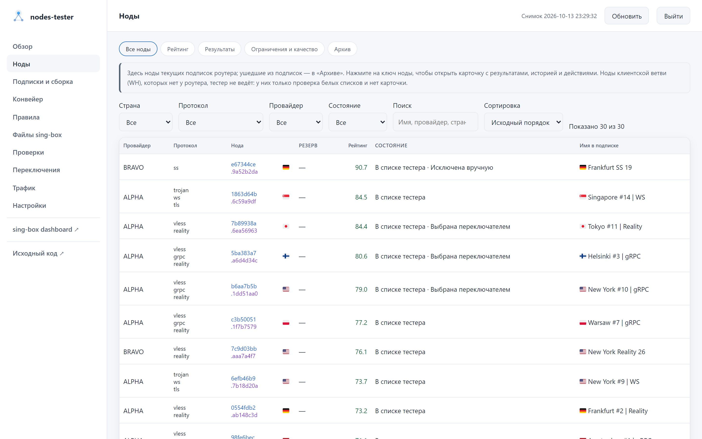
        </picture>
      </a>
    </td>
  </tr>
  <tr>
    <td><strong>Overview</strong> Database and tester state, summary figures and the chosen nodes of the groups.</td>
    <td><strong>All nodes</strong> Filters, search, sorting, rating and a link to the card.</td>
  </tr>
  <tr>
    <td>
      <a href="node-card-light.png">
        <picture>
          <source media="(prefers-color-scheme: dark)" srcset="node-card.png">
          <source media="(prefers-color-scheme: light)" srcset="node-card-light.png">
          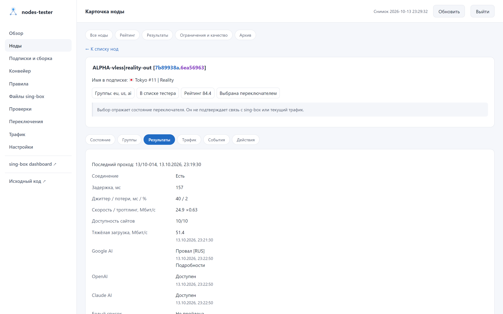
        </picture>
      </a>
    </td>
    <td>
      <a href="rating-light.png">
        <picture>
          <source media="(prefers-color-scheme: dark)" srcset="rating.png">
          <source media="(prefers-color-scheme: light)" srcset="rating-light.png">
          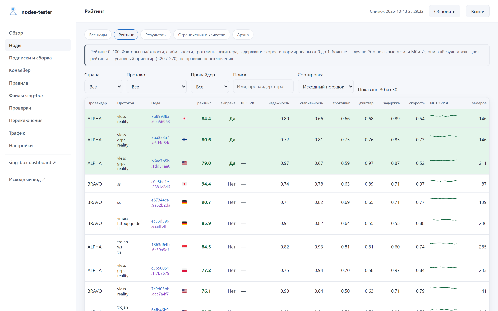
        </picture>
      </a>
    </td>
  </tr>
  <tr>
    <td><strong>Node card</strong> State, measurements, traffic, events and actions in one place.</td>
    <td><strong>Rating</strong> The total score and the normalised components by group.</td>
  </tr>
  <tr>
    <td>
      <a href="results-light.png">
        <picture>
          <source media="(prefers-color-scheme: dark)" srcset="results.png">
          <source media="(prefers-color-scheme: light)" srcset="results-light.png">
          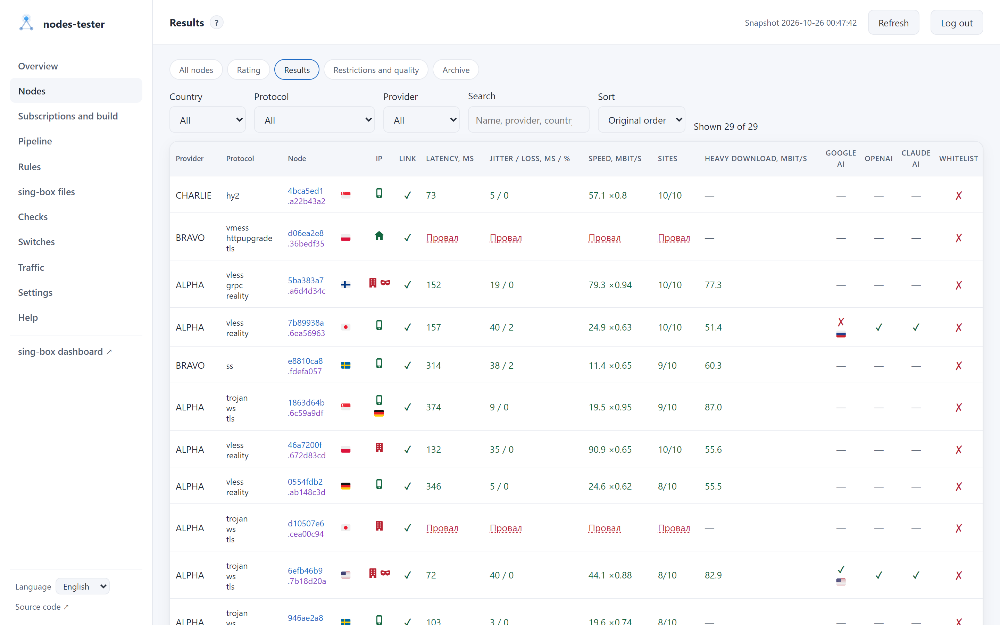
        </picture>
      </a>
    </td>
    <td>
      <a href="lifecycle-light.png">
        <picture>
          <source media="(prefers-color-scheme: dark)" srcset="lifecycle.png">
          <source media="(prefers-color-scheme: light)" srcset="lifecycle-light.png">
          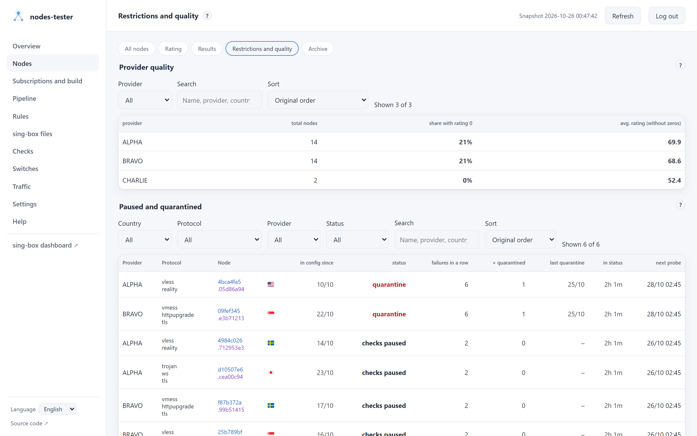
        </picture>
      </a>
    </td>
  </tr>
  <tr>
    <td><strong>Results</strong> Physical metrics with the time of each measurement, the exit IP type and access to Google AI, OpenAI and Claude.</td>
    <td><strong>Restrictions and quality</strong> Pauses, quarantine and a summary by provider.</td>
  </tr>
  <tr>
    <td>
      <a href="history-light.png">
        <picture>
          <source media="(prefers-color-scheme: dark)" srcset="history.png">
          <source media="(prefers-color-scheme: light)" srcset="history-light.png">
          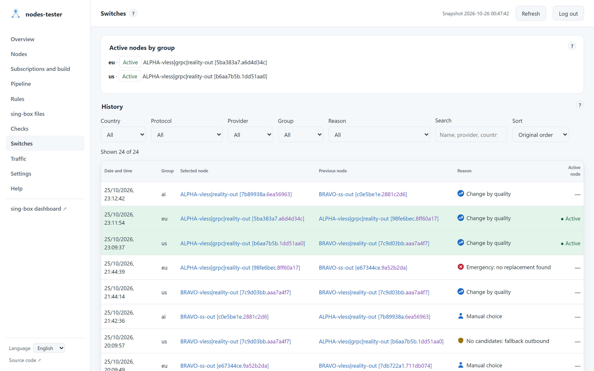
        </picture>
      </a>
    </td>
    <td>
      <a href="traffic-light.png">
        <picture>
          <source media="(prefers-color-scheme: dark)" srcset="traffic.png">
          <source media="(prefers-color-scheme: light)" srcset="traffic-light.png">
          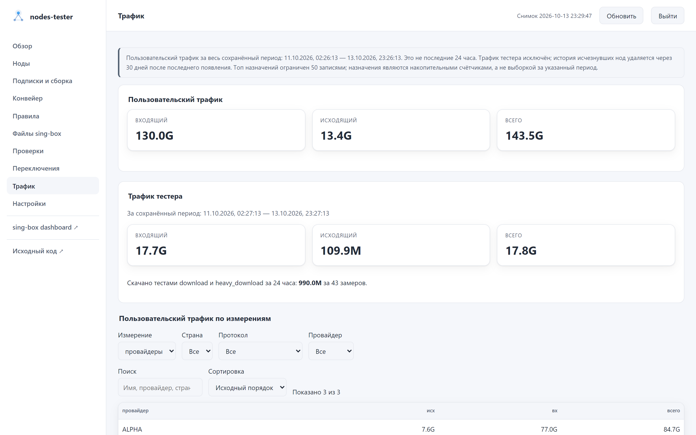
        </picture>
      </a>
    </td>
  </tr>
  <tr>
    <td><strong>Switches</strong> When, why and to which node a group switched.</td>
    <td><strong>Traffic</strong> The available period, directions and the most used nodes.</td>
  </tr>
</table>

## Configuration and control

<table>
  <tr>
    <td width="50%">
      <a href="subscriptions-light.png">
        <picture>
          <source media="(prefers-color-scheme: dark)" srcset="subscriptions.png">
          <source media="(prefers-color-scheme: light)" srcset="subscriptions-light.png">
          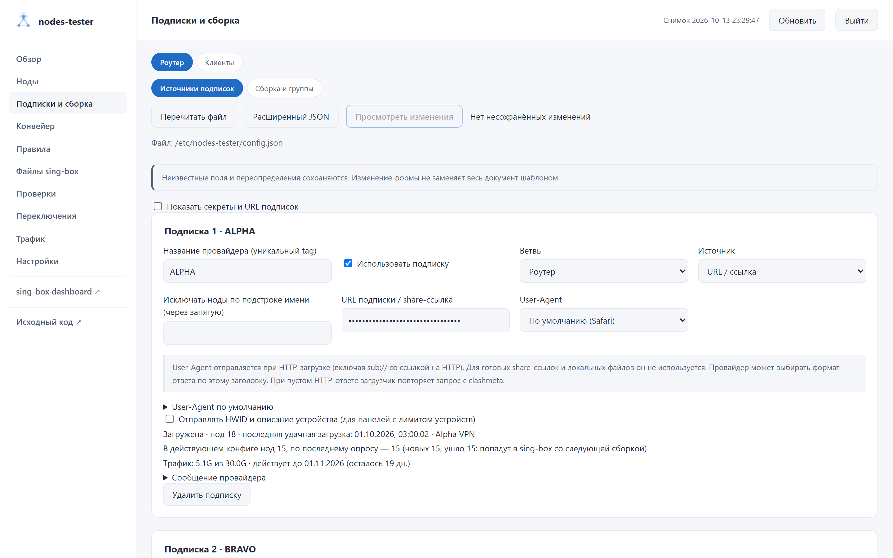
        </picture>
      </a>
    </td>
    <td width="50%">
      <a href="config-light.png">
        <picture>
          <source media="(prefers-color-scheme: dark)" srcset="config.png">
          <source media="(prefers-color-scheme: light)" srcset="config-light.png">
          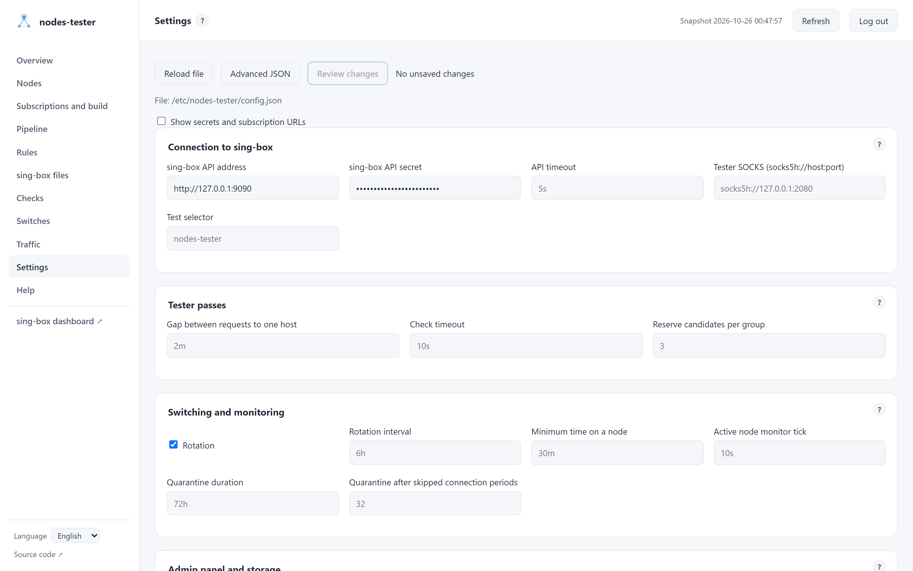
        </picture>
      </a>
    </td>
  </tr>
  <tr>
    <td><strong>Subscriptions and build</strong> Sources, secrets, forms and the advanced JSON.</td>
    <td><strong>Settings</strong> sing-box API, SOCKS, checks, switching, storage and dashboard.</td>
  </tr>
  <tr>
    <td colspan="2">
      <a href="runs-light.png">
        <picture>
          <source media="(prefers-color-scheme: dark)" srcset="runs.png">
          <source media="(prefers-color-scheme: light)" srcset="runs-light.png">
          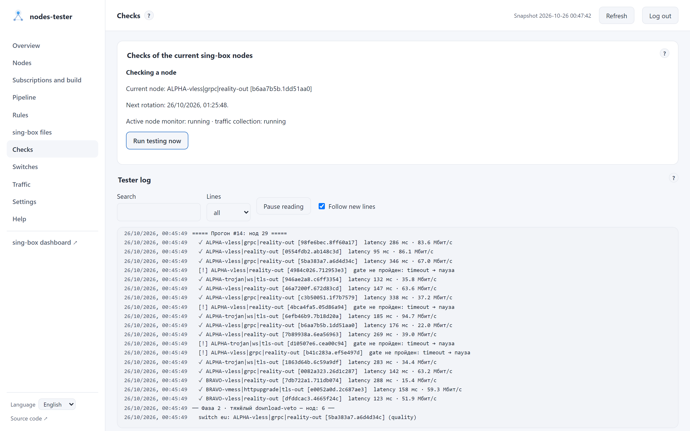
        </picture>
      </a>
    </td>
  </tr>
  <tr>
    <td colspan="2"><strong>Checks</strong> Tester stage, queue, the last result and the live log.</td>
  </tr>
  <tr>
    <td colspan="2">
      <a href="pipeline-light.png">
        <picture>
          <source media="(prefers-color-scheme: dark)" srcset="pipeline.png">
          <source media="(prefers-color-scheme: light)" srcset="pipeline-light.png">
          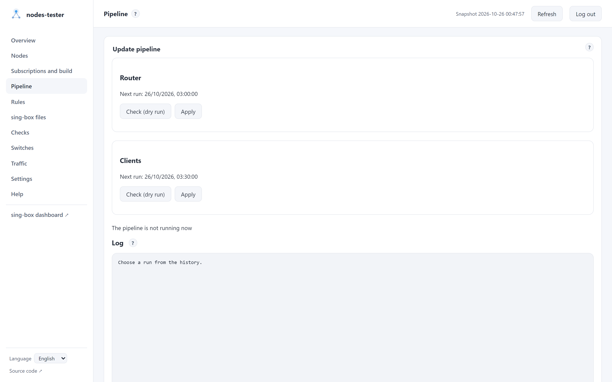
        </picture>
      </a>
    </td>
  </tr>
  <tr><td colspan="2"><strong>Pipeline</strong> Manual run, schedule, history and log.</td></tr>
  <tr>
    <td width="50%">
      <a href="singbox-light.png">
        <picture>
          <source media="(prefers-color-scheme: dark)" srcset="singbox.png">
          <source media="(prefers-color-scheme: light)" srcset="singbox-light.png">
          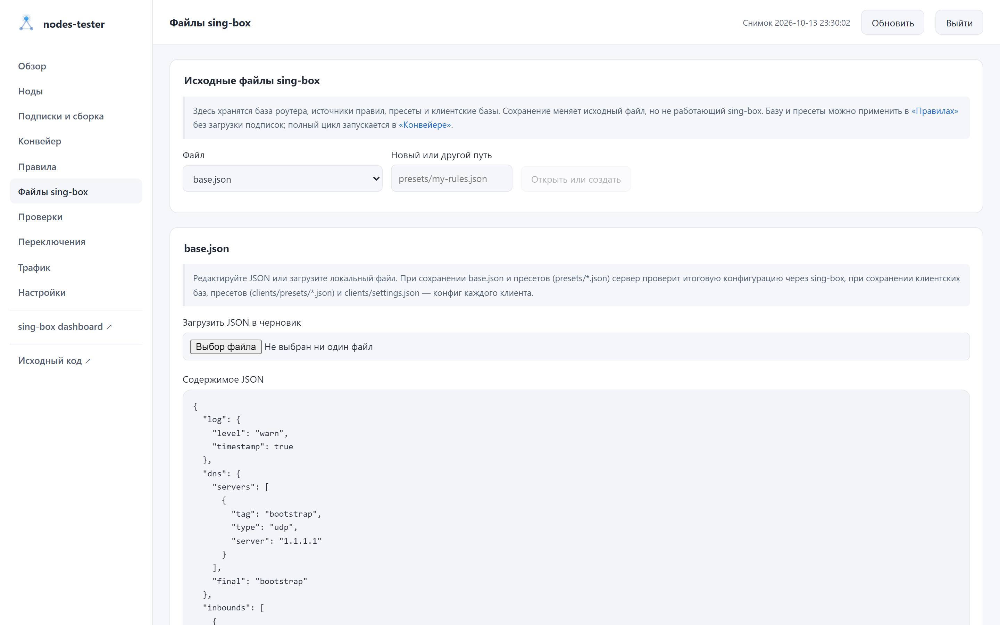
        </picture>
      </a>
    </td>
    <td width="50%">
      <a href="singbox-rules-light.png">
        <picture>
          <source media="(prefers-color-scheme: dark)" srcset="singbox-rules.png">
          <source media="(prefers-color-scheme: light)" srcset="singbox-rules-light.png">
          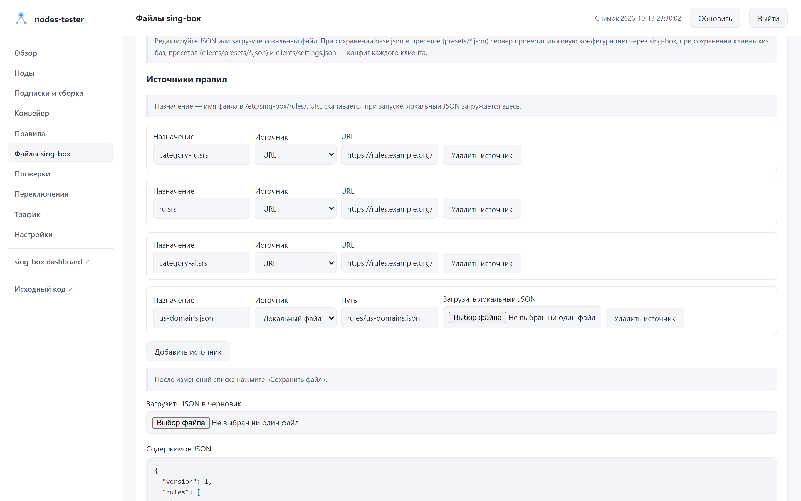
        </picture>
      </a>
    </td>
  </tr>
  <tr>
    <td><strong>sing-box files</strong> Base, client configs and version history.</td>
    <td><strong>Rule sources</strong> The download list and local JSON files.</td>
  </tr>
</table>

## Groups, rules and actions

### Node groups

<picture>
  <source media="(prefers-color-scheme: dark)" srcset="groups.png">
  <source media="(prefers-color-scheme: light)" srcset="groups-light.png">
  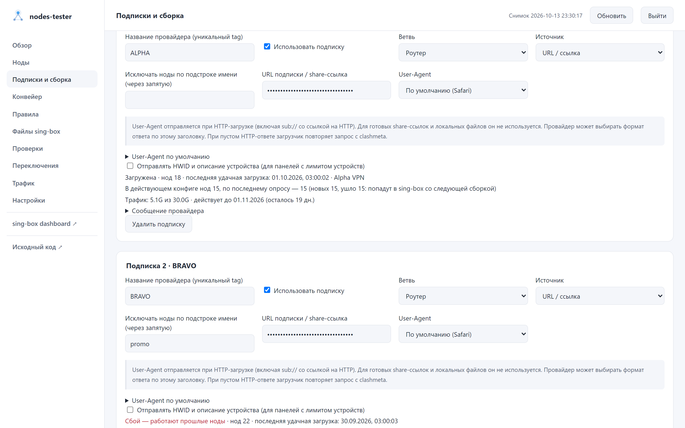
</picture>

### Client node groups

<picture>
  <source media="(prefers-color-scheme: dark)" srcset="client-groups.png">
  <source media="(prefers-color-scheme: light)" srcset="client-groups-light.png">
  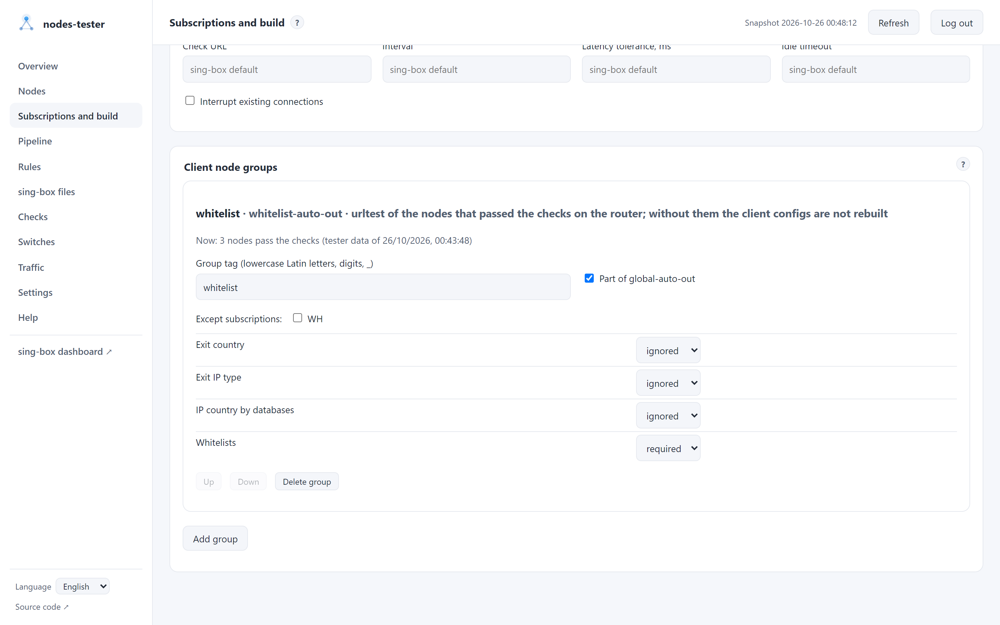
</picture>

A client group is a urltest of the nodes that passed its checks on the router, for example the whitelists.

### Clients and links

<picture>
  <source media="(prefers-color-scheme: dark)" srcset="clients.png">
  <source media="(prefers-color-scheme: light)" srcset="clients-light.png">
  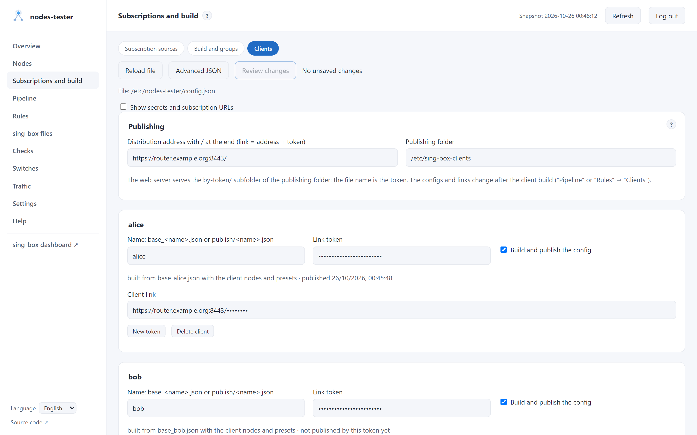
</picture>

The client list, link tokens and the state of every config.

### Rules and presets

<picture>
  <source media="(prefers-color-scheme: dark)" srcset="presets.png">
  <source media="(prefers-color-scheme: light)" srcset="presets-light.png">
  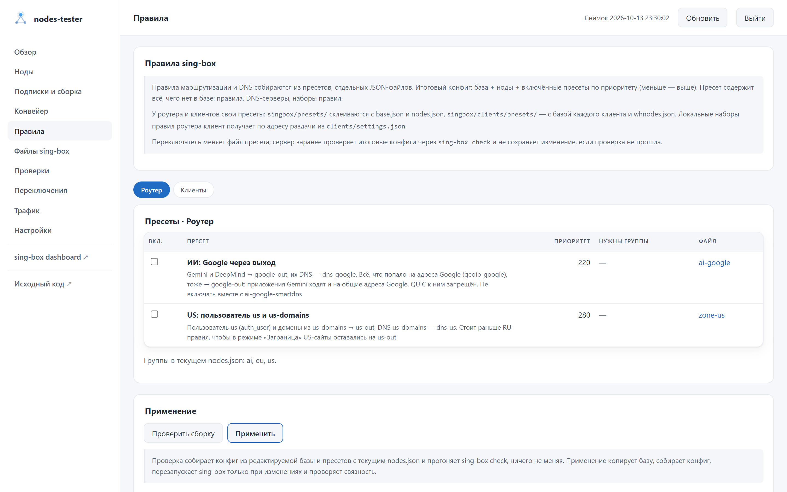
</picture>

### Node actions

<picture>
  <source media="(prefers-color-scheme: dark)" srcset="node-actions.png">
  <source media="(prefers-color-scheme: light)" srcset="node-actions-light.png">
  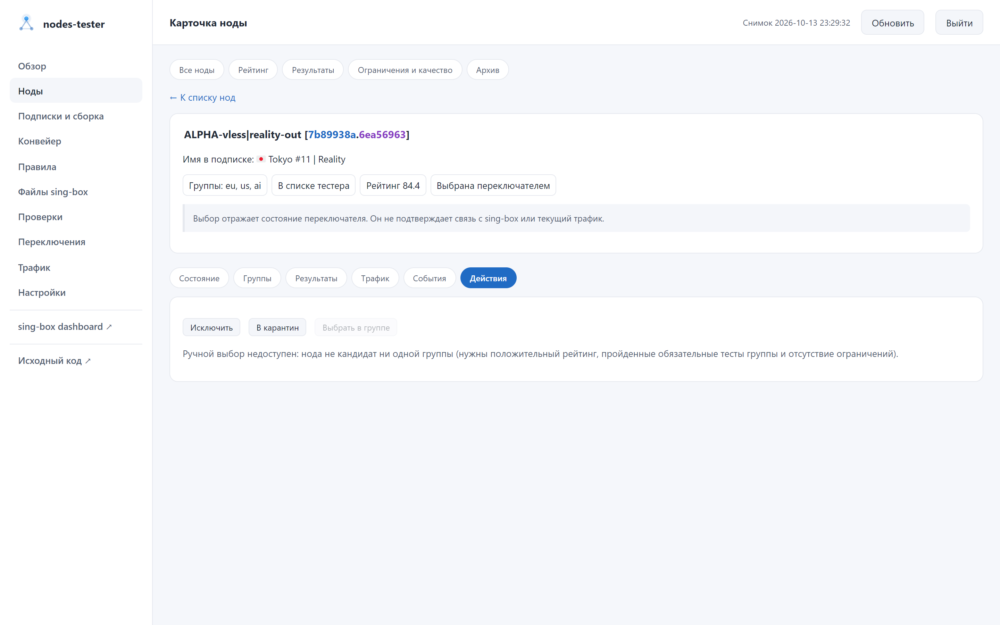
</picture>

## Mobile interface

  <a href="mobile-overview-light.png">
    <picture>
      <source media="(prefers-color-scheme: dark)" srcset="mobile-overview.png">
      <source media="(prefers-color-scheme: light)" srcset="mobile-overview-light.png">
      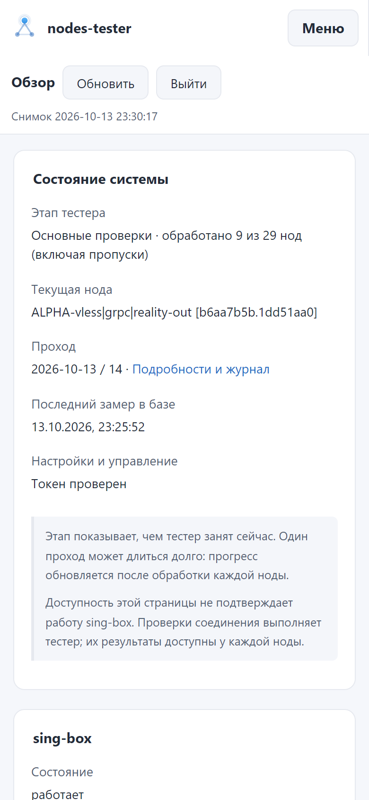
    </picture>
  </a>
  &nbsp;
  <a href="mobile-nodes-light.png">
    <picture>
      <source media="(prefers-color-scheme: dark)" srcset="mobile-nodes.png">
      <source media="(prefers-color-scheme: light)" srcset="mobile-nodes-light.png">
      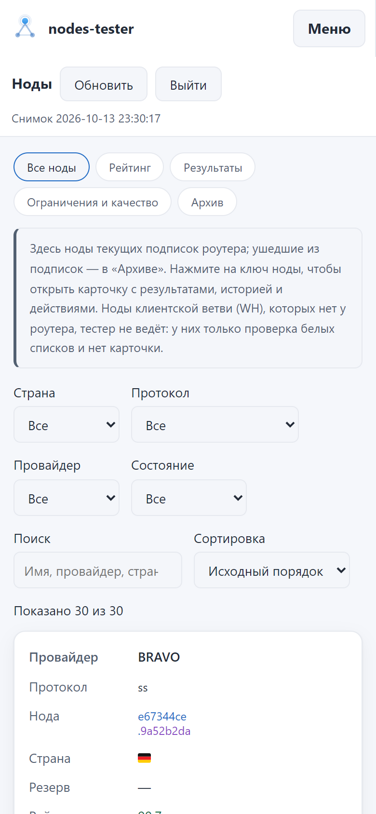
    </picture>
  </a>

The interface keeps the same sections and actions, and tables are rearranged for a narrow screen.
