[English](README.md) | **Русский**

# Веб-админка nodes-tester

[О проекте](../../README.ru.md) · [Руководство пользователя](../USAGE.ru.md) ·
[Устройство dashboard](../../dashboard/README.ru.md)

Изображения автоматически переключаются между светлой и тёмной темой GitHub. Нажмите на
скриншот, чтобы открыть исходный размер.

Галерея показывает интерфейс 0.11.0 на демонстрационных данных. Текущий порядок действий описан в [руководстве](../USAGE.ru.md).

## Основные экраны

<table>
  <tr>
    <td width="50%">
      <a href="ru/overview-light.png">
        <picture>
          <source media="(prefers-color-scheme: dark)" srcset="ru/overview.png">
          <source media="(prefers-color-scheme: light)" srcset="ru/overview-light.png">
          
        </picture>
      </a>
    </td>
    <td width="50%">
      <a href="ru/nodes-light.png">
        <picture>
          <source media="(prefers-color-scheme: dark)" srcset="ru/nodes.png">
          <source media="(prefers-color-scheme: light)" srcset="ru/nodes-light.png">
          
        </picture>
      </a>
    </td>
  </tr>
  <tr>
    <td><strong>Обзор</strong> Состояние БД и тестера, сводные показатели и выбранные ноды групп.</td>
    <td><strong>Все ноды</strong> Фильтры, поиск, сортировка, рейтинг и переход к карточке.</td>
  </tr>
  <tr>
    <td>
      <a href="ru/node-card-light.png">
        <picture>
          <source media="(prefers-color-scheme: dark)" srcset="ru/node-card.png">
          <source media="(prefers-color-scheme: light)" srcset="ru/node-card-light.png">
          
        </picture>
      </a>
    </td>
    <td>
      <a href="ru/rating-light.png">
        <picture>
          <source media="(prefers-color-scheme: dark)" srcset="ru/rating.png">
          <source media="(prefers-color-scheme: light)" srcset="ru/rating-light.png">
          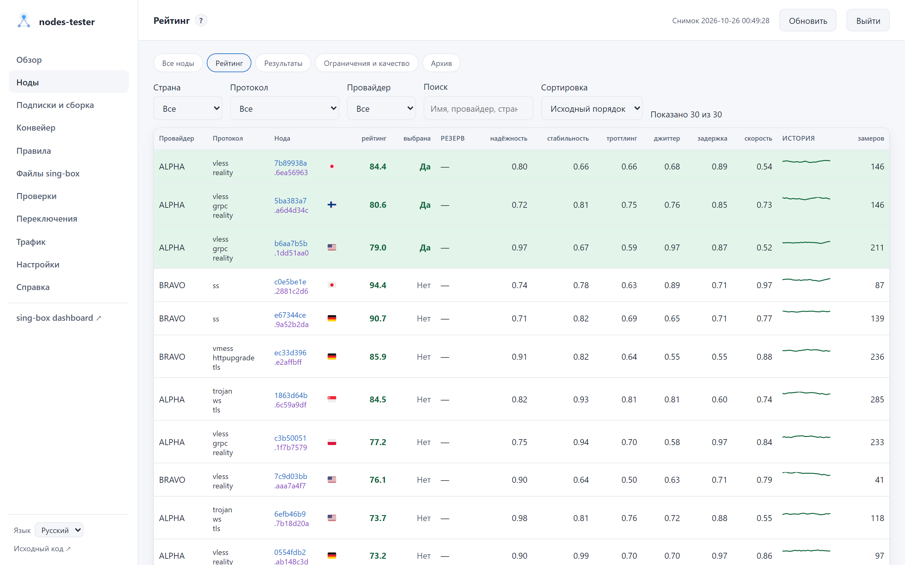
        </picture>
      </a>
    </td>
  </tr>
  <tr>
    <td><strong>Карточка ноды</strong> Состояние, измерения, трафик, события и действия в одном месте.</td>
    <td><strong>Рейтинг</strong> Итоговый балл и нормированные составляющие по группам.</td>
  </tr>
  <tr>
    <td>
      <a href="ru/results-light.png">
        <picture>
          <source media="(prefers-color-scheme: dark)" srcset="ru/results.png">
          <source media="(prefers-color-scheme: light)" srcset="ru/results-light.png">
          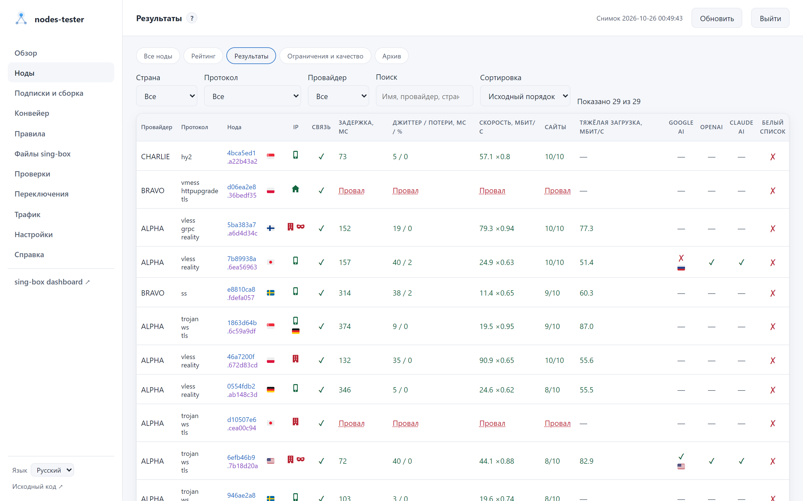
        </picture>
      </a>
    </td>
    <td>
      <a href="ru/lifecycle-light.png">
        <picture>
          <source media="(prefers-color-scheme: dark)" srcset="ru/lifecycle.png">
          <source media="(prefers-color-scheme: light)" srcset="ru/lifecycle-light.png">
          
        </picture>
      </a>
    </td>
  </tr>
  <tr>
    <td><strong>Результаты</strong> Физические метрики с временем каждого измерения, тип выходного IP и доступ к Google AI, OpenAI и Claude.</td>
    <td><strong>Ограничения и качество</strong> Паузы, карантин и сводка по провайдерам.</td>
  </tr>
  <tr>
    <td>
      <a href="ru/history-light.png">
        <picture>
          <source media="(prefers-color-scheme: dark)" srcset="ru/history.png">
          <source media="(prefers-color-scheme: light)" srcset="ru/history-light.png">
          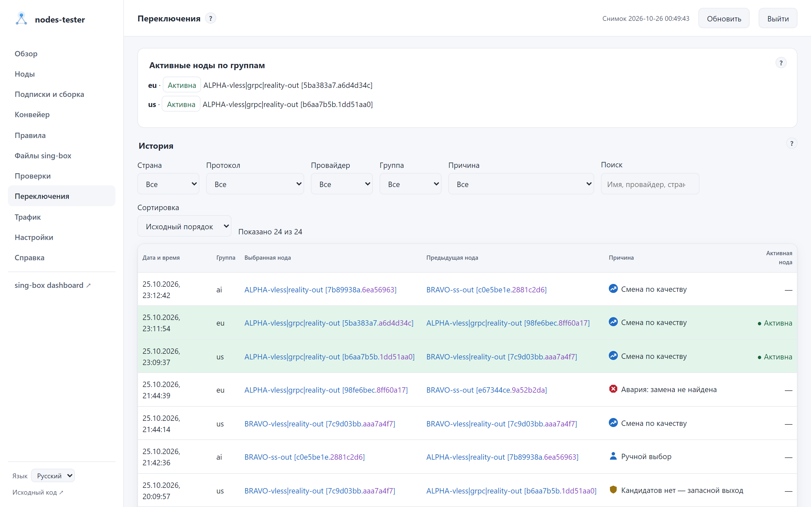
        </picture>
      </a>
    </td>
    <td>
      <a href="ru/traffic-light.png">
        <picture>
          <source media="(prefers-color-scheme: dark)" srcset="ru/traffic.png">
          <source media="(prefers-color-scheme: light)" srcset="ru/traffic-light.png">
          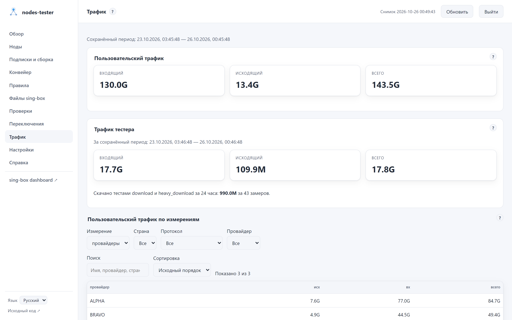
        </picture>
      </a>
    </td>
  </tr>
  <tr>
    <td><strong>Переключения</strong> Когда, почему и на какую ноду переключалась группа.</td>
    <td><strong>Трафик</strong> Доступный период, направления и наиболее используемые ноды.</td>
  </tr>
</table>

## Настройка и управление

<table>
  <tr>
    <td width="50%">
      <a href="ru/subscriptions-light.png">
        <picture>
          <source media="(prefers-color-scheme: dark)" srcset="ru/subscriptions.png">
          <source media="(prefers-color-scheme: light)" srcset="ru/subscriptions-light.png">
          
        </picture>
      </a>
    </td>
    <td width="50%">
      <a href="ru/config-light.png">
        <picture>
          <source media="(prefers-color-scheme: dark)" srcset="ru/config.png">
          <source media="(prefers-color-scheme: light)" srcset="ru/config-light.png">
          
        </picture>
      </a>
    </td>
  </tr>
  <tr>
    <td><strong>Подписки и сборка</strong> Источники, секреты, формы и расширенный JSON.</td>
    <td><strong>Настройки</strong> API sing-box, SOCKS, проверки, переключение, хранение и dashboard.</td>
  </tr>
  <tr>
    <td colspan="2">
      <a href="ru/runs-light.png">
        <picture>
          <source media="(prefers-color-scheme: dark)" srcset="ru/runs.png">
          <source media="(prefers-color-scheme: light)" srcset="ru/runs-light.png">
          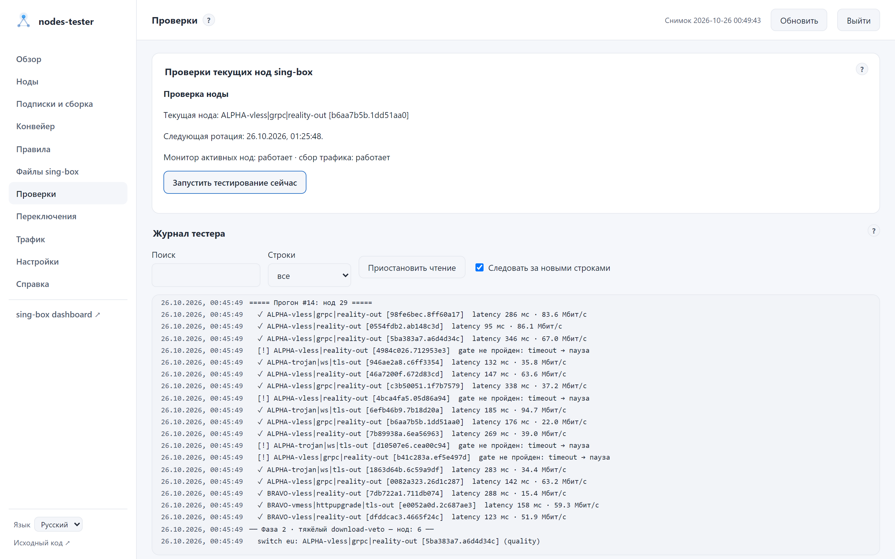
        </picture>
      </a>
    </td>
  </tr>
  <tr>
    <td colspan="2"><strong>Проверки</strong> Этап прохода, очередь, последний результат и живой журнал.</td>
  </tr>
  <tr>
    <td colspan="2">
      <a href="ru/pipeline-light.png">
        <picture>
          <source media="(prefers-color-scheme: dark)" srcset="ru/pipeline.png">
          <source media="(prefers-color-scheme: light)" srcset="ru/pipeline-light.png">
          
        </picture>
      </a>
    </td>
  </tr>
  <tr><td colspan="2"><strong>Конвейер</strong> Ручной запуск, расписание, история и журнал.</td></tr>
  <tr>
    <td width="50%">
      <a href="ru/singbox-light.png">
        <picture>
          <source media="(prefers-color-scheme: dark)" srcset="ru/singbox.png">
          <source media="(prefers-color-scheme: light)" srcset="ru/singbox-light.png">
          
        </picture>
      </a>
    </td>
    <td width="50%">
      <a href="ru/singbox-rules-light.png">
        <picture>
          <source media="(prefers-color-scheme: dark)" srcset="ru/singbox-rules.png">
          <source media="(prefers-color-scheme: light)" srcset="ru/singbox-rules-light.png">
          
        </picture>
      </a>
    </td>
  </tr>
  <tr>
    <td><strong>Файлы sing-box</strong> База, клиентские конфиги и история версий.</td>
    <td><strong>Источники правил</strong> Список загрузок и локальные JSON-файлы.</td>
  </tr>
</table>

## Группы, правила и действия

### Группы нод

<picture>
  <source media="(prefers-color-scheme: dark)" srcset="ru/groups.png">
  <source media="(prefers-color-scheme: light)" srcset="ru/groups-light.png">
  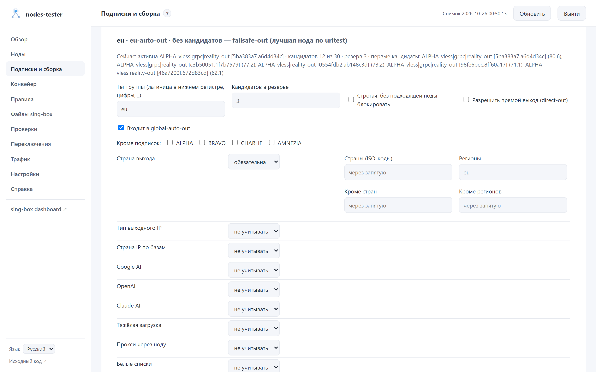
</picture>

### Группы нод клиентов

<picture>
  <source media="(prefers-color-scheme: dark)" srcset="ru/client-groups.png">
  <source media="(prefers-color-scheme: light)" srcset="ru/client-groups-light.png">
  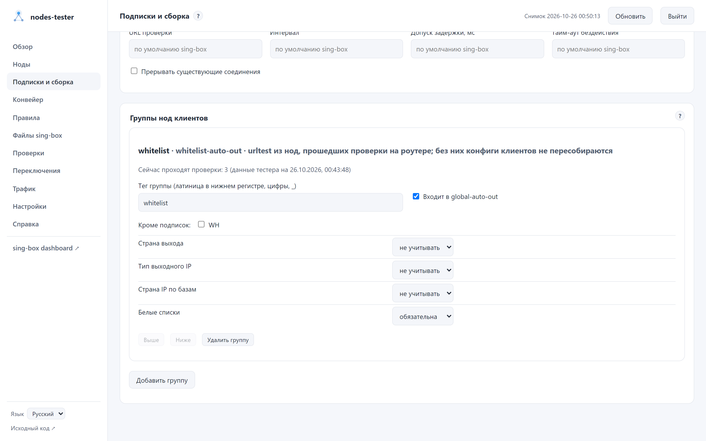
</picture>

Клиентская группа — urltest из нод, прошедших её проверки на роутере, например белые списки.

### Клиенты и ссылки

<picture>
  <source media="(prefers-color-scheme: dark)" srcset="ru/clients.png">
  <source media="(prefers-color-scheme: light)" srcset="ru/clients-light.png">
  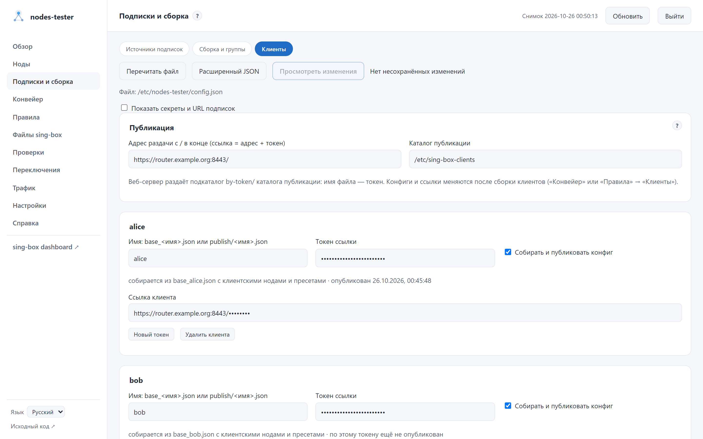
</picture>

Список клиентов, токены ссылок и состояние каждого конфига.

### Правила и пресеты

<picture>
  <source media="(prefers-color-scheme: dark)" srcset="ru/presets.png">
  <source media="(prefers-color-scheme: light)" srcset="ru/presets-light.png">
  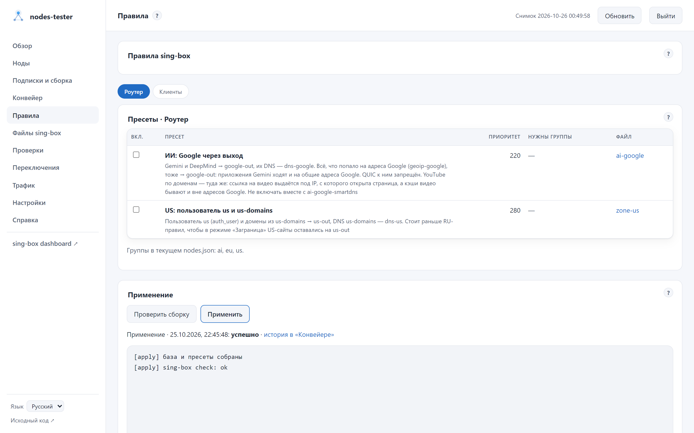
</picture>

### Действия с нодой

<picture>
  <source media="(prefers-color-scheme: dark)" srcset="ru/node-actions.png">
  <source media="(prefers-color-scheme: light)" srcset="ru/node-actions-light.png">
  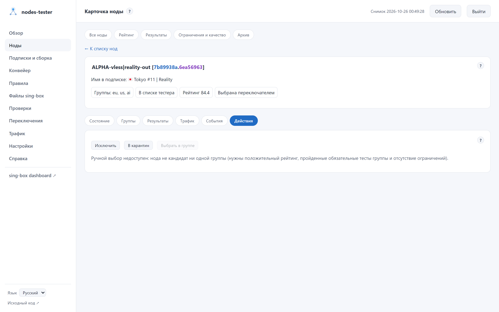
</picture>

## Мобильный интерфейс

  <a href="ru/mobile-overview-light.png">
    <picture>
      <source media="(prefers-color-scheme: dark)" srcset="ru/mobile-overview.png">
      <source media="(prefers-color-scheme: light)" srcset="ru/mobile-overview-light.png">
      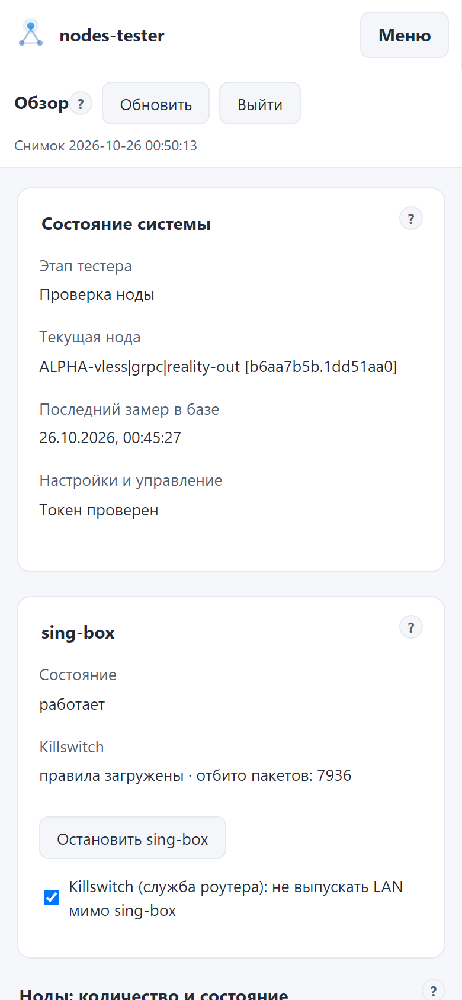
    </picture>
  </a>
  &nbsp;
  <a href="ru/mobile-nodes-light.png">
    <picture>
      <source media="(prefers-color-scheme: dark)" srcset="ru/mobile-nodes.png">
      <source media="(prefers-color-scheme: light)" srcset="ru/mobile-nodes-light.png">
      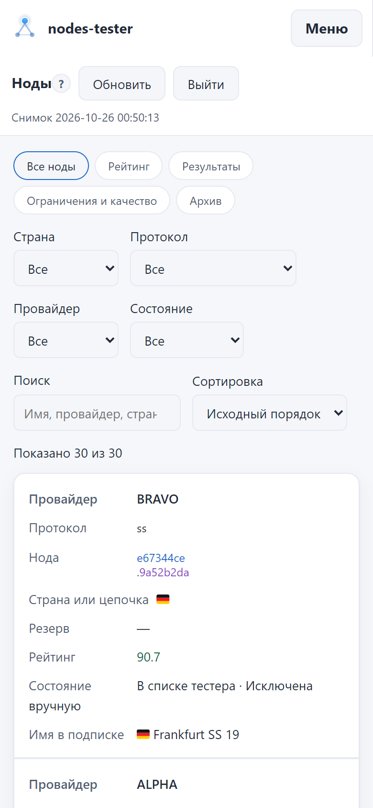
    </picture>
  </a>

Интерфейс сохраняет те же разделы и действия, а таблицы перестраиваются для узкого экрана.
